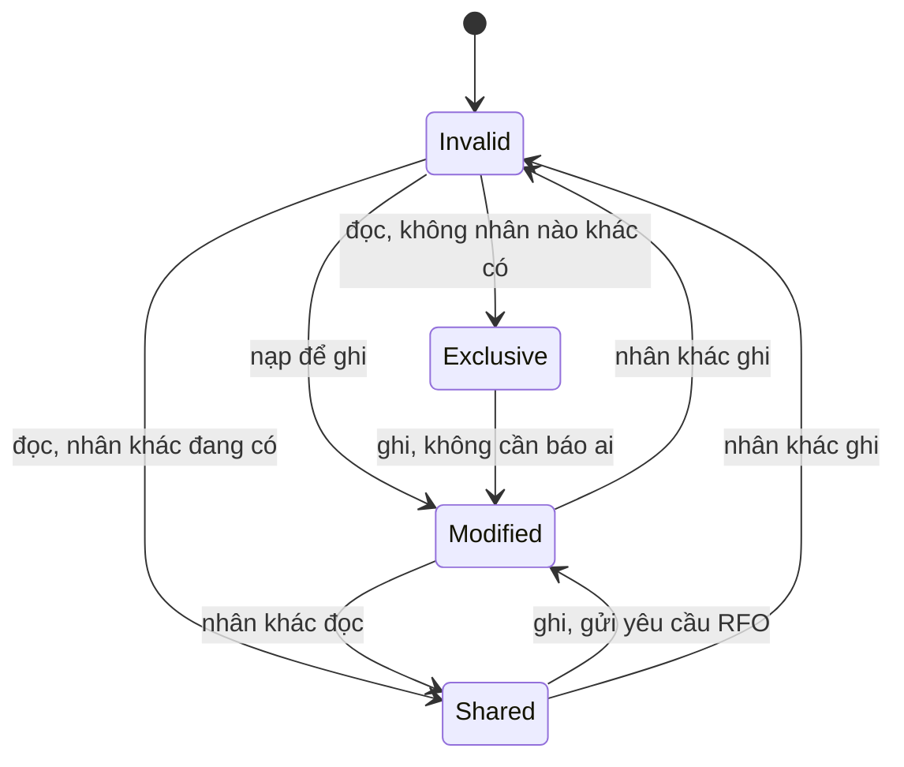
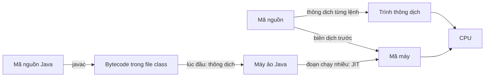

# Bài 2. Kiến trúc máy tính

> Tài liệu do Claude biên soạn từ các nguồn liệt kê ở cuối, ngày 2026-11-25. Bài này chưa dùng ngôn ngữ lập trình nào; ví dụ chạy bằng lệnh terminal trên Linux (VPS) hoặc macOS.

## Tóm tắt

CPU tính rất nhanh nhưng phần lớn thời gian phải **chờ dữ liệu**. Để bớt chờ, máy tính xếp bộ nhớ thành nhiều tầng: tầng càng gần CPU càng nhanh và càng nhỏ. Hiểu các tầng này giải thích được vì sao cùng một lượng dữ liệu mà cách đọc khác nhau cho tốc độ chênh nhau hàng chục lần, và vì sao nhiều nhân chạy cùng lúc không phải lúc nào cũng nhanh hơn.

## Vì sao cần học

Trong hệ thống đặt sân, trang "lịch trống trong ngày" phải đọc trạng thái của hàng trăm khung giờ trên nhiều sân. Nếu dữ liệu đó nằm liền nhau trong bộ nhớ, CPU đọc một lần được cả loạt; nếu nằm rải rác, mỗi lần đọc lại phải chờ RAM. Chênh lệch này không nằm ở thuật toán mà ở **cách dữ liệu được sắp xếp**.

<details>
<summary>Đoán trước khi đọc: lấy một giá trị từ RAM chậm hơn lấy từ cache gần CPU nhất khoảng bao nhiêu lần?</summary>

Theo số liệu Intel công bố cho bộ xử lý Pentium M: cache L1 mất khoảng 3 chu kỳ, RAM khoảng 240 chu kỳ, tức chậm hơn khoảng 80 lần [2]. Con số cụ thể thay đổi theo đời CPU, nhưng khoảng cách hàng chục lần là điều phần 2 sẽ giải thích.

</details>

## Kiến thức nền

[Bài 1. Biểu diễn dữ liệu](01-bieu-dien-du-lieu.md): bit, byte, hex và phép AND. Phần 3 dùng phép AND để tách địa chỉ.

## Nội dung chính

### 1. CPU làm gì với một lệnh

CPU giữ vài giá trị đang dùng ngay trong **thanh ghi**, nơi truy cập nhanh nhất, không quá 1 chu kỳ [2]. Mỗi lệnh đi qua nhiều giai đoạn nối tiếp nhau: giải mã lệnh, chuẩn bị tham số, rồi thực thi; các giai đoạn này xếp thành dây chuyền (pipeline) để nhiều lệnh được xử lý chồng lên nhau [2]. Dây chuyền bị khựng lại khi lệnh tiếp theo chưa sẵn sàng, ví dụ đang chờ dữ liệu từ bộ nhớ [2].

**Nhân và luồng phần cứng:** các nhân (core) gần như có bản riêng của mọi tài nguyên phần cứng và chạy độc lập với nhau; còn các luồng phần cứng trên cùng một nhân (hyper-thread) dùng chung gần như mọi thứ, kể cả cache L1 [2].

Thử ngay (kết quả trên máy dùng để soạn bài, một máy ảo Linux):

```bash
nproc     # 4: số CPU hệ điều hành thấy
```

Dừng lại và tự hỏi: vì sao hai luồng phần cứng trên cùng một nhân lại tranh nhau cache?

### 2. Bộ nhớ nhiều tầng

Bộ nhớ nhanh như CPU thì đắt hơn RAM thông thường nhiều bậc, nên máy tính dùng một ít bộ nhớ rất nhanh (SRAM) làm **cache**, đặt giữa CPU và RAM [2]. Cache được chia tầng: L1 (tách riêng cache lệnh L1i và cache dữ liệu L1d), L2, L3; tầng sau to hơn và chậm hơn tầng trước [2]. Ổ đĩa còn chậm hơn RAM nhiều bậc nữa [2].

![Số chu kỳ CPU để lấy dữ liệu từ thanh ghi, L1d, L2 và RAM trên Pentium M, theo số liệu Intel công bố [2]](assets/thang-do-tre.svg)

Đây là số liệu của một đời CPU cũ (2007) [2]; trên máy bạn con số sẽ khác. Điều cần nhớ là **tỉ lệ**: mỗi tầng xa hơn chậm hơn nhiều lần.

Thử ngay:

```bash
lscpu -C                                   # liệt kê các tầng cache của CPU (Linux)
getconf LEVEL1_DCACHE_LINESIZE             # 64: kích thước một cache line, tính bằng byte
dd if=/dev/zero of=test.bin bs=1M count=256 conv=fsync && rm test.bin
# 268435456 bytes (268 MB, 256 MiB) copied, 0.246 s, 1.1 GB/s
```

`lscpu` lấy thông tin CPU, kể cả các tầng cache, từ hệ điều hành; tùy chọn `-C` in chi tiết về cache [4]. Trên máy ảo, cột kích thước có thể để trống vì máy ảo không lộ thông tin này; hãy chạy trên VPS hoặc máy thật của bạn. Trên macOS, thay bằng `sysctl -a | grep -i cache` (chưa chạy thử trong môi trường soạn bài).

Dừng lại và tự hỏi: nếu mọi lần đọc đều phải xuống RAM, CPU sẽ ngồi chờ bao nhiêu phần trăm thời gian?

### 3. Cache line và tính cục bộ

Cache không lưu từng byte lẻ. Nó lưu từng khối liền nhau gọi là **cache line**, thường là 64 byte [2]. Khi CPU cần một byte, **cả line chứa byte đó** được nạp vào L1d [2]. Địa chỉ của line có được bằng cách đưa các bit thấp về 0: với line 64 byte là 6 bit thấp, và 6 bit đó chính là vị trí của byte trong line [2].

![Đọc 1 byte thì CPU nạp cả cache line 64 byte chứa byte đó; tách địa chỉ 0x1234 bằng 6 bit thấp [2]](assets/cache-line.svg)

Cache hiệu quả được là nhờ chương trình có **tính cục bộ** [2]:

- **Theo thời gian:** dữ liệu vừa dùng thường sẽ được dùng lại sớm.
- **Theo không gian:** dữ liệu nằm cạnh nhau thường được dùng cùng nhau, vì vậy nạp cả line là có lợi.

**Đọc tuần tự và đọc ngẫu nhiên.** Drepper đo cùng một danh sách phần tử, lần đầu xếp liền nhau, lần sau xáo trộn ngẫu nhiên [2]:

- Khi đọc tuần tự, CPU đoán trước được và **nạp sẵn** (prefetch) line kế tiếp, nên dù dữ liệu không vừa cache L2, mỗi phần tử vẫn chỉ tốn khoảng 9 chu kỳ thay vì hơn 200 chu kỳ của RAM [2].
- Khi đọc ngẫu nhiên, CPU không đoán được, nên mỗi phần tử tốn khoảng 450 chu kỳ trở lên khi dữ liệu lớn [2].

Đây là lý do một danh sách phần tử nằm liền nhau trong bộ nhớ thường được duyệt nhanh hơn một danh sách mà mỗi phần tử nằm một nơi. Ở bài 22 bạn sẽ đo điều này trên hai kiểu danh sách thật của Java.

Dừng lại và tự hỏi: một bảng 1 triệu số nguyên 4 byte, đọc tuần tự từ đầu đến cuối, phải nạp khoảng bao nhiêu cache line?

### 4. Nhiều nhân và cache: giao thức MESI

Mỗi nhân có cache L1 riêng, nhưng mọi nhân phải thấy cùng một nội dung bộ nhớ; việc giữ điều này gọi là **nhất quán cache** (cache coherency) [2]. Giao thức quan trọng nhất là **MESI**, đặt theo bốn trạng thái của một cache line [2]:

| Trạng thái | Ý nghĩa |
| --- | --- |
| Modified | Nhân này đã sửa line; đây là bản duy nhất trong mọi cache |
| Exclusive | Chưa sửa, và không nhân nào khác có line này |
| Shared | Chưa sửa, và có thể nhân khác cũng đang có |
| Invalid | Line không dùng được |



Sơ đồ rút gọn theo mô tả của Drepper [2]. Điểm quan trọng: khi một nhân ghi vào line mà nhân khác cũng đang giữ, các bản ở nhân khác bị đánh dấu Invalid và lần đọc sau phải nạp lại; yêu cầu này gọi là RFO và tốn kém [2]. Vì vậy nhiều luồng cùng ghi vào một vùng nhớ sẽ chậm, và thêm luồng không phải lúc nào cũng nhanh hơn: trong một phép đo của Drepper, chạy 4 luồng chỉ nhanh hơn 1 luồng khoảng 2 lần [2].

**Nhất quán cache chưa đủ cho lập trình đa luồng.** Với code người dùng, việc giữ cache nhất quán diễn ra hoàn toàn tự động [2]. Nhưng CPU được phép thực hiện các thao tác đọc, ghi bộ nhớ theo thứ tự khác với thứ tự trong chương trình, miễn là bản thân chương trình đó không nhận ra khác biệt [3]; và các thao tác ghi của một CPU có thể được CPU khác thấy theo thứ tự khác [3]. Vì vậy lập trình đa luồng cần thêm công cụ để ép thứ tự và đảm bảo luồng này thấy thay đổi của luồng kia. Bạn sẽ học các công cụ đó ở bài 29–30.

Dừng lại và tự hỏi: hai biến khác nhau nhưng nằm chung một cache line, mỗi nhân liên tục ghi vào một biến, điều gì xảy ra với line đó?

### 5. Từ mã nguồn đến mã máy

CPU chỉ chạy được **mã máy**. Có ba cách đưa chương trình viết bằng ngôn ngữ lập trình tới mã máy:

- **Biên dịch trước:** dịch toàn bộ chương trình sang mã máy một lần rồi mới chạy.
- **Thông dịch:** một chương trình khác đọc và thực hiện từng lệnh một.
- **Bytecode kết hợp JIT,** cách Java làm (bạn sẽ học Java từ bài 14):
  - Máy ảo Java không biết gì về ngôn ngữ Java, nó chỉ hiểu một định dạng nhị phân gọi là file class [5]. File class chứa các lệnh của máy ảo, gọi là **bytecode** [6].
  - Máy ảo HotSpot mặc định **thông dịch** bytecode, và chỉ **biên dịch tức thời** (JIT) sang mã máy những phương thức được chạy đủ nhiều lần [7].
  - Đánh đổi ở đây là: trình thông dịch khởi động ngay nhưng chạy chậm, còn mã đã biên dịch thì cần thời gian chuẩn bị nhưng chạy nhanh [8].



Dừng lại và tự hỏi: vì sao một ứng dụng Java thường chậm trong vài giây đầu rồi nhanh dần?

## Hiểu nhầm thường gặp

- **"Đọc RAM gần như miễn phí."** Theo số liệu Pentium M, một lần đọc RAM tốn khoảng 240 chu kỳ, so với khoảng 3 chu kỳ của L1d [2].
- **"Đọc 1 byte thì chỉ lấy đúng 1 byte."** CPU luôn nạp cả cache line chứa byte đó, thường 64 byte [2].
- **"Thêm luồng là chạy nhanh hơn tương ứng."** Các luồng tranh nhau đường truyền tới bộ nhớ và tranh cache line; trong đo đạc của Drepper, 4 luồng chỉ nhanh khoảng gấp đôi 1 luồng [2].
- **"Cache đã nhất quán thì các luồng luôn thấy thay đổi của nhau đúng thứ tự."** Nhất quán cache không đảm bảo thứ tự các thao tác bộ nhớ giữa các CPU [3].
- **"Ngôn ngữ chạy trên máy ảo thì luôn chậm vì là thông dịch."** HotSpot biên dịch các đoạn chạy nhiều sang mã máy [7].

## Liên hệ capstone

- **Dữ liệu hay dùng nên ở gần nơi xử lý:** cùng ý tưởng với cache CPU, ở Giai đoạn 2 hệ thống đặt sân sẽ đặt dữ liệu đọc nhiều (lịch trống, bảng giá) vào Redis thay vì lần nào cũng hỏi database.
- **Nhiều yêu cầu cùng ghi một chỗ thì chậm và dễ sai:** nhiều người cùng đặt một khung giờ là tình huống "nhiều luồng ghi cùng dữ liệu". Bài 29–30 (đa luồng) và 35–36 (transaction, lock) sẽ xử lý chuyện này.

## Bài tập

Làm bằng giấy bút hoặc terminal. Làm bài nào thì gửi bài đó để được chấm.

1. **(cơ bản)** Theo bảng số liệu Pentium M trong phần 2, đọc từ RAM chậm hơn đọc từ L2 bao nhiêu lần?
2. **(cơ bản)** Cache L1d 32 KB, mỗi line 64 byte. L1d chứa được bao nhiêu line?
3. **(cơ bản)** Với line 64 byte, địa chỉ `0x2A7F` nằm trong line bắt đầu ở địa chỉ nào, và ở vị trí thứ mấy trong line? Kiểm tra bằng `printf '%X\n' $(( 0x2A7F & ~0x3F ))`.
4. **(vận dụng)** Giả sử đọc RAM mất 200 chu kỳ, đọc cache mất 15 chu kỳ. Một chương trình dùng 100 phần tử, mỗi phần tử 100 lần. Tính tổng số chu kỳ cho việc đọc bộ nhớ khi không có cache và khi mọi phần tử đều nằm trong cache.
5. **(vận dụng)** Một bảng 1.000.000 số nguyên 4 byte đọc tuần tự từ đầu đến cuối phải nạp khoảng bao nhiêu cache line 64 byte? Nếu mỗi lần đọc rơi vào một line khác nhau thì sao?
6. **(vận dụng)** Trên VPS hoặc máy của bạn: tìm số nhân, kích thước từng tầng cache và kích thước cache line. Ghi lại lệnh đã dùng và kết quả.
7. **(vận dụng)** Đo độ trễ bằng `ping -c 5` tới `127.0.0.1`, tới router nhà bạn và tới `1.1.1.1`. Lập bảng và so sánh với độ trễ RAM (đổi chu kỳ ra thời gian với giả định CPU 3 GHz).
8. **(vận dụng)** Hai nhân cùng đọc một cache line, sau đó nhân 1 ghi vào line đó. Trạng thái MESI của line ở mỗi nhân trước và sau lần ghi là gì?
9. **(nâng cao)** Hai biến khác nhau nằm chung một cache line, mỗi nhân liên tục ghi một biến. Dựa vào MESI, giải thích vì sao chương trình chậm dù hai nhân không hề dùng chung biến nào.
10. **(nâng cao)** Giải thích vì sao một ứng dụng chạy trên máy ảo có JIT thường chậm lúc mới khởi động rồi nhanh dần.

## Nguồn

1. [What every programmer should know about memory, Part 1](https://lwn.net/Articles/250967/) — Ulrich Drepper, LWN.net — mục 1, 2 — 2007 — truy cập 2026-11-25
2. [Memory part 2: CPU caches](https://lwn.net/Articles/252125/) — Ulrich Drepper, LWN.net — mục 3 đến 3.4 — 2007 — truy cập 2026-11-25
3. [Linux kernel memory barriers](https://www.kernel.org/doc/Documentation/memory-barriers.txt) — tài liệu nhân Linux — mục Abstract memory access model — truy cập 2026-11-25
4. [lscpu(1) — Linux manual page](https://man7.org/linux/man-pages/man1/lscpu.1.html) — util-linux — truy cập 2026-11-25
5. [The Java Virtual Machine Specification, Java SE 25: Chapter 1. Introduction](https://docs.oracle.com/javase/specs/jvms/se25/html/jvms-1.html) — §1.2 — truy cập 2026-11-25
6. [The Java Virtual Machine Specification, Java SE 20: Chapter 1. Introduction](https://docs.oracle.com/javase/specs/jvms/se20/html/jvms-1.html) — §1.2 — truy cập 2026-11-25
7. [JRockit to HotSpot Migration Guide: Compilation Optimization](https://docs.oracle.com/en/java/javase/11/jrockit-hotspot/compilation-optimization.html) — Oracle, JDK 11 — truy cập 2026-11-25
8. [How the JIT compiler boosts Java performance in OpenJDK](https://developers.redhat.com/index%2Ephp/articles/2021/06/23/how-jit-compiler-boosts-java-performance-openjdk) — Roland Westrelin, Red Hat Developer — 2021 — truy cập 2026-11-25

## Đọc thêm

- Toàn bộ loạt bài của Drepper (9 phần trên LWN), đặc biệt phần 5 và 6 về những gì lập trình viên làm được với cache.
- Sách *Computer Systems: A Programmer's Perspective* (Bryant, O'Hallaron), chương 4 đến 6.

## Báo cáo kiểm chứng

- Số nguồn: 8 (hạng A: 5 gồm tài liệu nhân Linux, man page, đặc tả JVM hai bản, tài liệu Oracle; hạng B: 3 gồm hai phần bài viết của Drepper trên LWN và bài của kỹ sư OpenJDK trên Red Hat Developer). Phần 2 của Drepper chỉ đọc 100.000 ký tự đầu, đủ cho mục 3 đến 3.4. Nguồn [3], [5], [6], [8] đọc qua trích đoạn kết quả tìm kiếm.
- Số liệu chu kỳ là của Pentium M và Pentium 4 (2007), luôn ghi kèm đời CPU khi dẫn.
- Đánh dấu chưa kiểm chứng: lệnh `sysctl` trên macOS và lệnh `ping` (môi trường soạn bài chặn mạng) chưa chạy thử; đã ghi rõ trong bài.
- Lệnh đã chạy thật: `nproc`, `getconf LEVEL1_DCACHE_LINESIZE`, `lscpu -C`, `dd`, và phép tính địa chỉ `0x1234 & ~0x3F` = `0x1200`.
- Hình: 2 SVG, 2 Mermaid. Các giá trị trong hình lấy từ [2]; phép tách địa chỉ trong hình đã tính lại bằng terminal. Sơ đồ MESI chỉ gồm các chuyển trạng thái được mô tả trong văn bản của [2].
- Phạm vi kiến thức: không có code Java; phần JIT chỉ mô tả khái niệm và ghi "học ở bài 14".
