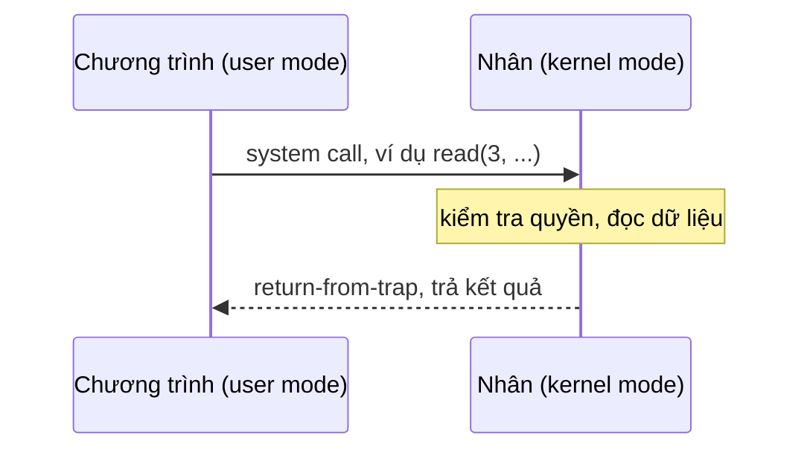
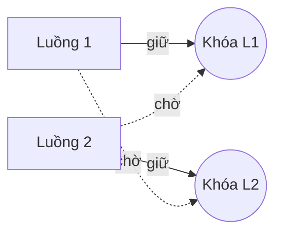

# Bài 3. Hệ điều hành

> Tài liệu do Claude biên soạn từ các nguồn liệt kê ở cuối, ngày 2026-11-25. Ví dụ chạy bằng lệnh terminal trên Linux (VPS); bài này chưa dùng ngôn ngữ lập trình.

## Tóm tắt

Hệ điều hành chia sẻ một CPU, một vùng RAM và các thiết bị cho rất nhiều chương trình cùng lúc, mà vẫn giữ được quyền kiểm soát. Bài này đi qua những khái niệm mà backend gặp hằng ngày: system call, process và thread, context switch, bộ nhớ ảo, đồng bộ giữa các luồng, file descriptor và các cách chờ I/O. Cuối bài, bạn sẽ hiểu vì sao Nginx phục vụ được rất nhiều kết nối mà không cần mỗi kết nối một luồng.

## Vì sao cần học

Khi hệ thống đặt sân chạy trên server, mỗi request là việc của một luồng; nhiều người cùng đặt một khung giờ là nhiều luồng cùng đụng vào một dữ liệu; server hết bộ nhớ thì có thể bị nhân Linux tắt bớt process. Hiểu hệ điều hành giúp bạn đọc được những gì đang xảy ra khi server chậm, treo hoặc chết.

<details>
<summary>Đoán trước khi đọc: hai luồng cùng tăng một biến đếm 10 triệu lần mỗi luồng, kết quả có chắc chắn là 20 triệu không?</summary>

Không. Trong thí nghiệm của OSTEP, kết quả lần chạy này là 19.345.221, lần sau là 19.221.041 [3]. Phần 4 giải thích vì sao.

</details>

## Kiến thức nền

[Bài 2. Kiến trúc máy tính](02-kien-truc-may-tinh.md): thanh ghi, cache, nhiều nhân.

## Nội dung chính

### 1. Kernel, user mode và system call

CPU có ít nhất hai chế độ chạy [2]:

- **User mode:** chế độ hạn chế, nơi chương trình bình thường chạy. Ở đây chương trình không được tự ý làm I/O; làm thế thì CPU báo lỗi và hệ điều hành thường sẽ tắt chương trình đó [2].
- **Kernel mode:** chế độ của nhân hệ điều hành, được làm mọi việc, kể cả các thao tác đặc quyền [2].

Muốn đọc file, gửi dữ liệu qua mạng hay xin thêm bộ nhớ, chương trình phải nhờ nhân qua một **system call**. System call dùng một lệnh đặc biệt (trap) vừa nhảy vào nhân vừa nâng lên kernel mode; làm xong, nhân dùng lệnh return-from-trap để quay lại chương trình và hạ về user mode [2].



Thử ngay: `strace` in ra các system call một chương trình gọi.

```bash
echo hi > f.txt
strace -e trace=openat,read,write cat f.txt
# openat(AT_FDCWD, "f.txt", O_RDONLY)     = 3
# read(3, "hi\n", 131072)                 = 3
# write(1, "hi\n", 3)                     = 3
```

Lệnh `cat` nhờ nhân mở file và nhận về **số 3**, đọc 3 byte qua số đó, rồi ghi 3 byte ra **số 1**. Những con số này là file descriptor, xem phần 6.

Dừng lại và tự hỏi: vì sao không cho chương trình tự đọc thẳng ổ đĩa cho nhanh?

### 2. Process và thread

**Process** là một chương trình đang chạy, có không gian địa chỉ riêng. **Thread** (luồng) là một dòng thực thi bên trong process. Các luồng trong cùng process dùng chung bộ nhớ toàn cục và heap, nhưng mỗi luồng có **stack riêng** [5]. Chúng còn dùng chung nhiều thứ khác, trong đó có PID và các file đang mở [5]. Mỗi luồng có thanh ghi và bộ đếm chương trình riêng [3].

![Không gian địa chỉ của process một luồng và hai luồng: stack tách riêng, heap và code dùng chung [3]](assets/process-va-thread.svg)

Dùng luồng thay vì nhiều process khi các phần việc cần chia sẻ nhiều dữ liệu; dùng process khi các phần việc tách biệt, ít chia sẻ [3]. Trên Linux, mỗi luồng ứng với một thực thể mà nhân lập lịch riêng [5].

Thử ngay:

```bash
sleep 300 &                        # chạy một process ở nền
ps -o pid,ppid,nlwp,stat,cmd -p $!  # NLWP = số luồng
grep -E "^(State|PPid|Threads)" /proc/$!/status
# State:  S (sleeping)
# PPid:   7
# Threads:        1
```

Dừng lại và tự hỏi: hai luồng cùng ghi vào một biến trên heap thì có cần nhân can thiệp không?

### 3. Context switch và lập lịch

Để nhiều process cùng chạy trên ít CPU, hệ điều hành cho mỗi process chạy một lúc rồi đổi sang process khác [2]. Nó lấy lại quyền điều khiển nhờ **ngắt định kỳ của bộ đếm giờ** (timer interrupt), kể cả khi chương trình đang chạy một vòng lặp vô tận [2]. Phần quyết định chạy process nào tiếp theo gọi là **bộ lập lịch** (scheduler) [2].

**Context switch** là việc lưu thanh ghi của process đang chạy rồi nạp thanh ghi của process sắp chạy [2]. Chuyển giữa hai luồng của cùng một process cũng phải lưu và nạp thanh ghi, nhưng **không phải đổi bảng trang** vì không gian địa chỉ vẫn như cũ [3]. Năm 1996, một context switch tốn khoảng 6 micro giây; các hệ thống hiện đại nhanh hơn gần một bậc, dưới 1 micro giây [2]. Ngoài chi phí trực tiếp đó, process mới chạy còn gặp cache và TLB chưa có dữ liệu của mình (bài 2).

Dừng lại và tự hỏi: vì sao chuyển giữa hai luồng của cùng process thường rẻ hơn chuyển giữa hai process?

### 4. Đồng bộ: race condition, mutex, semaphore, deadlock

**Race condition.** Lệnh `counter = counter + 1` thật ra gồm ba bước: đọc giá trị vào thanh ghi, cộng 1, ghi trở lại bộ nhớ [3]. Nếu luồng 1 vừa đọc được 50 thì bị chuyển sang luồng 2, luồng 2 đọc 50, cộng lên 51 và ghi; quay lại, luồng 1 cũng ghi 51. Tăng hai lần mà biến chỉ tăng một [3]. Kết quả phụ thuộc vào thời điểm các luồng chạy, đó là **race condition** [3].

- **Critical section** là đoạn code truy cập dữ liệu dùng chung và không được để nhiều luồng chạy cùng lúc [3].
- **Mutual exclusion** (loại trừ lẫn nhau) đảm bảo khi một luồng đang ở trong critical section thì các luồng khác phải chờ [3]. Công cụ thường dùng là **mutex** (khóa): luồng nào giữ khóa mới được vào.
- **Semaphore** là một số nguyên không bao giờ âm, với hai thao tác: tăng 1, và giảm 1; nếu giá trị đang là 0 thì thao tác giảm phải chờ tới khi nó lớn hơn 0 [6]. Semaphore khởi tạo bằng N cho phép tối đa N luồng cùng dùng một tài nguyên.

**Deadlock** xảy ra khi luồng 1 giữ khóa L1 và chờ L2, trong khi luồng 2 giữ L2 và chờ L1; không ai chạy tiếp được [4].



Deadlock chỉ xảy ra khi có đủ bốn điều kiện; thiếu một điều kiện là không thể deadlock [4]:

| Điều kiện | Ý nghĩa |
| --- | --- |
| Loại trừ lẫn nhau | Tài nguyên chỉ một luồng giữ được tại một thời điểm, ví dụ khóa |
| Giữ và chờ | Luồng giữ tài nguyên đã có trong khi chờ thêm tài nguyên khác |
| Không bị tước | Không thể ép lấy lại tài nguyên một luồng đang giữ |
| Chờ vòng tròn | Có một vòng các luồng, luồng này chờ thứ luồng kế tiếp đang giữ |

Cách phòng tránh thực tế nhất là **luôn lấy khóa theo một thứ tự cố định**, ví dụ luôn lấy L1 trước L2, để không bao giờ có chờ vòng tròn [4].

Dừng lại và tự hỏi: hai người cùng chuyển tiền cho nhau, mỗi giao dịch khóa tài khoản người gửi trước rồi tới người nhận. Có thể deadlock không?

### 5. Bộ nhớ ảo, trang và page fault

Mỗi process thấy một không gian địa chỉ riêng như thể có cả bộ nhớ cho riêng mình; đó là **địa chỉ ảo**. **Bảng trang** (page table) ánh xạ địa chỉ ảo mà CPU dùng sang địa chỉ vật lý trên RAM, và mỗi process có bảng trang riêng [7]. Bộ nhớ được chia thành các **trang**; với trang 4 KB, 12 bit thấp của địa chỉ là vị trí trong trang [7]. Việc dịch địa chỉ do phần cứng **MMU** đảm nhận, có một bộ đệm nhỏ là **TLB** để tăng tốc [7].

Khi MMU không dịch được một địa chỉ, nó gây ra **page fault** để nhân xử lý [7]. Page fault không phải lúc nào cũng là lỗi: nó xảy ra bình thường khi nhân chỉ cấp bộ nhớ lúc thực sự dùng tới (lazy allocation), khi sao chép trang lúc ghi (copy-on-write), hoặc khi trang đã bị đẩy ra vùng **swap** trên ổ đĩa [7]. Nếu chương trình truy cập vùng nhớ không được phép, nhân gửi tín hiệu Segmentation Fault và process thường bị dừng [7]. Khi bộ nhớ cạn mà nhân không dọn được chỗ, nó gọi **OOM killer** để tắt bớt process [7].

Thử ngay:

```bash
getconf PAGESIZE    # 4096
```

Dừng lại và tự hỏi: vì sao hai process có thể cùng dùng một địa chỉ ảo mà không ghi đè dữ liệu của nhau?

### 6. File descriptor và inode

**File descriptor** là một số nguyên nhỏ, không âm, là chỉ số trỏ vào bảng các file đang mở của process; các system call sau đó dùng số này để chỉ tới file [8]. Ba số đầu tiên thường là 0 (đầu vào chuẩn), 1 (đầu ra chuẩn), 2 (lỗi chuẩn). Không chỉ file thường: pipe, socket mạng, thậm chí một epoll instance cũng được trả về dưới dạng file descriptor [9].

Mỗi file có một **inode** chứa siêu dữ liệu: số inode, loại file và quyền, số hard link, chủ sở hữu, kích thước, các mốc thời gian [10]. Tên file không nằm trong danh sách đó; tên nằm trong thư mục chứa file (bạn sẽ gặp lại điều này khi học hard link ở bài 4).

Thử ngay:

```bash
ls -l /proc/$$/fd                         # file descriptor của shell hiện tại
echo hi > f.txt && stat -c 'inode=%i links=%h size=%s' f.txt
# inode=871 links=1 size=3
```

Dừng lại và tự hỏi: một server mở 10.000 kết nối mạng cùng lúc thì cần khoảng bao nhiêu file descriptor?

### 7. Các cách chờ I/O: blocking, non-blocking, multiplexing

| Cách | Khi chưa có dữ liệu | Hệ quả |
| --- | --- | --- |
| Blocking | Luồng đứng chờ tới khi có dữ liệu | Muốn phục vụ nhiều kết nối thì cần nhiều luồng |
| Non-blocking | Lời gọi trả về ngay, báo "chưa có, thử lại sau" | Chương trình phải tự hỏi lại, dễ phí CPU |
| I/O multiplexing | Một lời gọi theo dõi nhiều file descriptor, báo cái nào sẵn sàng | Một luồng phục vụ được nhiều kết nối |

`epoll` của Linux theo dõi nhiều file descriptor để xem cái nào có thể đọc hoặc ghi, và **mở rộng tốt khi số file descriptor rất lớn**; `epoll_wait` chặn luồng gọi cho tới khi có sự kiện [9]. Nginx hỗ trợ nhiều cách xử lý kết nối và tự chọn cách hiệu quả nhất trên nền tảng; trên Linux 2.6 trở lên đó là epoll [11]. Đây là lý do Nginx phục vụ được nhiều kết nối với ít luồng: thay vì mỗi kết nối một luồng ngồi chờ, một luồng hỏi nhân "kết nối nào đã sẵn sàng" rồi xử lý lần lượt. Netty (bài sau) dùng cùng ý tưởng; virtual thread của Java 21 (bài 25) giải quyết cùng bài toán theo cách khác.

Dừng lại và tự hỏi: 10.000 kết nối dùng 10.000 luồng blocking thì tốn những gì so với một luồng dùng epoll?

## Hiểu nhầm thường gặp

- **"Thread là process nhỏ, có bộ nhớ riêng."** Các luồng dùng chung heap và bộ nhớ toàn cục; chỉ stack và thanh ghi là riêng [3][5].
- **"Code chạy đúng một lần thì luôn đúng."** Race condition cho kết quả khác nhau giữa các lần chạy [3].
- **"Page fault nghĩa là chương trình bị lỗi."** Phần lớn page fault là bình thường (lazy allocation, copy-on-write, swap) [7].
- **"File descriptor là đường dẫn file."** Nó chỉ là một chỉ số vào bảng file đang mở của process [8].
- **"Muốn phục vụ nhiều kết nối thì phải nhiều luồng."** I/O multiplexing cho phép ít luồng phục vụ nhiều kết nối [9][11].

## Liên hệ capstone

- **Đặt trùng khung giờ** là race condition kinh điển: hai request cùng kiểm tra "khung giờ còn trống" rồi cùng ghi. Yêu cầu N-01 của capstone (100 request đồng thời, đúng 1 thành công) sẽ được giải ở bài 35–36 bằng transaction và lock của database.
- **Chuyển tiền, hoàn tiền giữa các ví** cần lấy khóa theo thứ tự cố định để tránh deadlock.
- **Triển khai:** Nginx đứng trước ứng dụng ở Giai đoạn 5 chính là nhờ mô hình epoll ở phần 7.

## Bài tập

Làm bằng giấy bút hoặc trên VPS. Làm bài nào thì gửi bài đó để được chấm.

1. **(cơ bản)** Liệt kê 3 thứ các luồng trong cùng process dùng chung và 2 thứ mỗi luồng có riêng.
2. **(cơ bản)** Trên VPS, chạy `sleep 300 &` rồi đọc `/proc/<pid>/status`. Ghi lại State, PPid, Threads và giải thích từng dòng.
3. **(cơ bản)** Chạy `ls -l /proc/$$/fd`. Ba file descriptor 0, 1, 2 trỏ tới đâu?
4. **(vận dụng)** Chạy `strace -c ls /`. System call nào được gọi nhiều nhất? Đoán xem nó dùng để làm gì.
5. **(vận dụng)** Biến `counter` bắt đầu là 50; hai luồng cùng chạy `counter = counter + 1`, mỗi lần gồm ba bước đọc, cộng, ghi. Viết ra một thứ tự xen kẽ cho kết quả 51 và một thứ tự cho kết quả 52.
6. **(vận dụng)** Hai giao dịch chuyển tiền chạy cùng lúc: A chuyển cho B, B chuyển cho A; mỗi giao dịch khóa tài khoản người gửi trước, rồi khóa người nhận. Chỉ ra đủ bốn điều kiện deadlock, rồi đề xuất cách sửa.
7. **(vận dụng)** Bãi đỗ xe có 3 chỗ được quản lý bằng một semaphore khởi tạo bằng 3. Mô tả giá trị semaphore khi lần lượt 4 xe vào, rồi 1 xe ra.
8. **(vận dụng)** Dùng `stat` xem một file bất kỳ. Inode lưu những gì? Tên file có nằm trong inode không?
9. **(nâng cao)** So sánh chi phí khi phục vụ 10.000 kết nối bằng 10.000 luồng blocking và bằng một luồng dùng epoll: bộ nhớ (stack), context switch, độ phức tạp của code.
10. **(nâng cao)** Kể hai tình huống page fault xảy ra mà chương trình hoàn toàn bình thường, và một tình huống page fault dẫn tới process bị dừng.

## Nguồn

1. [Operating Systems: Three Easy Pieces](https://pages.cs.wisc.edu/~remzi/OSTEP/) — R. và A. Arpaci-Dusseau, Đại học Wisconsin — phiên bản 1.10 — truy cập 2026-11-25
2. [OSTEP chương 6: Mechanism: Limited Direct Execution](https://pages.cs.wisc.edu/~remzi/OSTEP/cpu-mechanisms.pdf) — mục 6.2, 6.3, phần "How long context switches take" — truy cập 2026-11-25
3. [OSTEP chương 26: Concurrency: An Introduction](https://pages.cs.wisc.edu/~remzi/OSTEP/threads-intro.pdf) — mục 26.1 đến 26.4 — truy cập 2026-11-25
4. [OSTEP chương 32: Common Concurrency Problems](https://pages.cs.wisc.edu/~remzi/OSTEP/threads-bugs.pdf) — mục 32.3 — truy cập 2026-11-25
5. [pthreads(7) — Linux manual page](https://man7.org/linux/man-pages/man7/pthreads.7.html) — man-pages 6.19 — truy cập 2026-11-25
6. [sem_overview(7) — Linux manual page](https://man7.org/linux/man-pages/man7/sem_overview.7.html) — man-pages 6.19 — truy cập 2026-11-25
7. [Linux kernel documentation: Page Tables](https://docs.kernel.org/mm/page_tables.html) — mục MMU, TLB, and Page Faults — truy cập 2026-11-25
8. [man-pages commit: open.2 — FD là chỉ số vào bảng file descriptor của process](https://git.tldp.org/LDP/man-pages/commit/5c3611aa446d09464366e1c403c32c77ac0895c5) — Michael Kerrisk — truy cập 2026-11-25
9. [epoll(7) — Linux manual page](https://man7.org/linux/man-pages/man7/epoll.7.html) — man-pages 6.19 — truy cập 2026-11-25
10. [inode(7) — Linux manual page](https://man7.org/linux/man-pages/man7/inode.7.html) — man-pages 6.19 — truy cập 2026-11-25
11. [nginx: Connection processing methods](https://nginx.org/en/docs/events.html) — truy cập 2026-11-25

## Đọc thêm

- OSTEP các chương 4 (Processes), 13 (Address Spaces), 18 (Paging), 31 (Semaphores), 33 (Event-based Concurrency), 39 (Files and Directories).
- Sách *The Linux Programming Interface* (Michael Kerrisk), chương 4 (File I/O) và 63 (I/O models).

## Báo cáo kiểm chứng

- Số nguồn: 11 (hạng A: 7 gồm 5 man page và commit của dự án man-pages, tài liệu nhân Linux, tài liệu Nginx; hạng B: 4 gồm trang chủ và 3 chương của giáo trình OSTEP). Nguồn [7], [8], [11] đọc qua trích đoạn kết quả tìm kiếm; các nguồn còn lại mở toàn văn.
- Khẳng định đã trích dẫn: 38.
- Đánh dấu chưa kiểm chứng: 0. Câu về cache và TLB sau context switch suy ra từ bài 2, không trích nguồn riêng.
- Lệnh đã chạy thật: `strace -e trace=openat,read,write cat`, `strace -c ls /`, `sleep 300 &` kèm `ps` và `/proc/<pid>/status`, `ls -l /proc/$$/fd`, `stat`, `getconf PAGESIZE`.
- Hình: 1 SVG theo hình 26.1 của [3]; 2 sơ đồ Mermaid (system call theo [2], deadlock theo hình 32.7 của [4]).
- Phạm vi kiến thức: không có code; tên công nghệ chưa học (Netty, virtual thread) chỉ nhắc tên và bài sẽ học.
