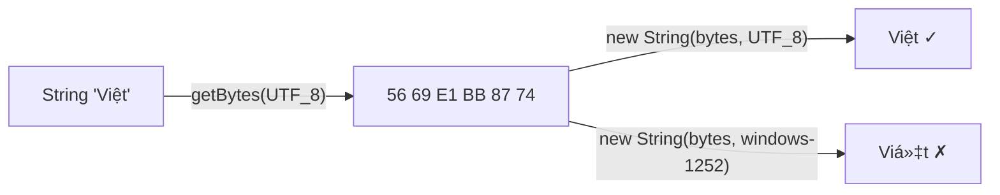

> Tài liệu tham khảo do Claude biên soạn từ các nguồn liệt kê ở cuối, ngày 2026-11-24, cho Java SE 21 (JDK 21) và PostgreSQL 17. Ghi chú của mình nằm ở [01-bieu-dien-du-lieu.md](../01-bieu-dien-du-lieu.md).

# Bài 1. Biểu diễn dữ liệu

## Tóm tắt

Trong máy, số nguyên, số thực và chữ đều chỉ là dãy bit; cái quyết định ý nghĩa của dãy bit là **quy ước diễn giải** (kiểu dữ liệu, bảng mã). Bài này đi qua các quy ước quan trọng nhất: hệ nhị phân và hex, số bù hai, phép toán bit, số thực IEEE 754, Unicode với UTF-8 và UTF-16, và thứ tự byte. Học xong, bạn giải thích được vì sao `Integer.MAX_VALUE + 1` ra số âm, vì sao `0.1 + 0.2 != 0.3`, vì sao tiền phải dùng `BigDecimal`, và vì sao chữ tiếng Việt đôi khi biến thành `Việt`.

## Vì sao cần học

Cơ sở Quận 7 đặt tỉ lệ tăng giờ cao điểm 15% (R-05 cho phép mỗi cơ sở tự đặt tỉ lệ). Giá gốc một khung 30 phút là 45.000 đ. Một bạn trong nhóm viết:

```java
double peak = 45000 * (1 + 0.15);
long price = (long) peak;
```

<details>
<summary>Đoán trước khi đọc: <code>price</code> bằng bao nhiêu?</summary>

Kết quả chạy thật trên JDK 21:

```
51749.99999999999   // peak
51749               // price
```

Thiếu 1 đồng. `0.15` không biểu diễn chính xác được bằng số thực nhị phân, nên phép nhân ra một số nhỉnh dưới 51750; ép kiểu từ số thực sang số nguyên thì làm tròn về phía 0 [1], nên mất luôn phần lẻ. Nhân lên hàng nghìn đơn mỗi tháng, báo cáo doanh thu (F-42) sẽ lệch với tiền thực thu. Mục 4 giải thích tận gốc.
</details>

## Kiến thức nền

Đây là bài đầu tiên của lộ trình, không cần bài trước. Chỉ cần biết khai báo biến và chạy một file Java (`java File.java`).

## Nội dung chính

### 1. Hệ nhị phân, thập lục phân; bit, byte, word

**Bắt đầu từ ví dụ.** Số 42 ở hệ thập phân nghĩa là 4×10 + 2. Cùng con số đó ở hệ nhị phân là `101010` = 1×32 + 0×16 + 1×8 + 0×4 + 1×2 + 0×1. Hệ nào cũng vậy: mỗi vị trí là một lũy thừa của cơ số.

- **Thập phân → nhị phân:** chia liên tiếp cho 2, ghi số dư, đọc ngược từ dưới lên. 42 → 21 dư 0 → 10 dư 1 → 5 dư 0 → 2 dư 1 → 1 dư 0 → 0 dư 1, đọc ngược: `101010`.
- **Nhị phân ↔ hex:** vì 16 = 2⁴, mỗi chữ số hex ứng đúng với 4 bit. Gom 4 bit từ phải sang: `10 1010` → `0010 1010` → `2A`. Đây là lý do lập trình viên thích hex: nó là cách viết gọn của nhị phân, đọc ngược lại cũng không phải tính toán.

Java cho viết thẳng hai hệ này trong code bằng tiền tố `0b` và `0x`:

```java
int x = 0x2A;
System.out.println(x + " " + Integer.toBinaryString(x));
```

```
42 101010
```

**Bit, byte, word.** Bit là một chữ số nhị phân. Byte là 8 bit: kiểu `byte` của Java là số nguyên 8 bit [1], và RFC 3629 gọi đơn vị 8 bit là *octet* [5]. Word là kích thước dữ liệu "tự nhiên" mà CPU xử lý trong một lần, phụ thuộc kiến trúc máy [Chưa kiểm chứng, sẽ học kỹ ở Bài 2]. Với Java, bạn không cần quan tâm word, vì số bit của các kiểu số nguyên và số thực được đặc tả cố định [1], không đổi theo máy.

> **Dừng lại và tự hỏi:** `0xFF` bằng bao nhiêu ở hệ thập phân, và cần bao nhiêu bit để viết nó?

### 2. Số nguyên có dấu và số bù hai; phạm vi kiểu; tràn số

**Ví dụ trước.** Một byte có 8 bit, tức 2⁸ = 256 mẫu bit. Nếu chỉ biểu diễn số không âm thì được 0..255. Nhưng kiểu `byte` của Java có phạm vi -128..127 [1]. Mẫu `1111 1111` nghĩa là -1 chứ không phải 255. Quy ước làm điều đó gọi là **số bù hai** (two's complement), và Java dùng nó cho cả bốn kiểu `byte`, `short`, `int`, `long` [1].

**Cơ chế.** Với n bit, số âm -x được lưu bằng mẫu bit của số không dấu 2ⁿ - x. Tài liệu `Integer.toBinaryString` nói đúng điều này: với số âm, giá trị in ra là "đối số cộng 2³²" [2]. Ví dụ `-1` kiểu int được lưu như 2³² - 1, tức 32 bit 1:

```java
System.out.println(Integer.toBinaryString(-1));  // 11111111111111111111111111111111
System.out.println(Integer.toHexString(-1));     // ffffffff
```

Hệ quả rút ra từ quy ước này (tự kiểm được bằng phép tính):

- Bit trái nhất bằng 1 thì số âm, bằng 0 thì số không âm.
- Đổi dấu một số: đảo hết bit rồi cộng 1. Vì đảo bit của x cho ra 2ⁿ - 1 - x, cộng 1 thành 2ⁿ - x, đúng là cách lưu -x.
- Cộng hai mẫu bit theo kiểu số không dấu rồi bỏ phần nhớ vượt quá n bit cũng cho đúng kết quả có dấu, vì mọi thứ đều tính theo modulo 2ⁿ. Cùng một phép cộng nhị phân phục vụ cả hai cách diễn giải.

**Phạm vi trong Java** [1][2]:

| Kiểu | Số bit | Nhỏ nhất | Lớn nhất |
| --- | --- | --- | --- |
| `byte` | 8 | -128 | 127 |
| `short` | 16 | -32768 | 32767 |
| `int` | 32 | -2147483648 (-2³¹) | 2147483647 (2³¹ - 1) |
| `long` | 64 | -9223372036854775808 | 9223372036854775807 |
| `char` | 16, không dấu | 0 | 65535 |

**Tràn số.** Hãy tưởng tượng 256 mẫu bit của một byte xếp thành vòng tròn. Cộng 1 là bước theo chiều kim đồng hồ. Từ 127 (`0111 1111`) bước thêm một ô thì sang `1000 0000`, tức -128.

![Vòng số bù hai 8 bit: cộng 1 vào 127 thì quay vòng sang -128, vì mẫu bit 1000 0000 được diễn giải là -128 [1][2]](assets/vong-so-bu-hai.svg)

Đặc tả Java nói thẳng: các toán tử số nguyên **không báo tràn số theo bất kỳ cách nào**; ngoại lệ duy nhất là `/` và `%` ném `ArithmeticException` khi chia cho 0 [1]. Ví dụ ngay trong đặc tả: `1000000 * 1000000` kiểu int in ra `-727379968` [1].

**Thử ngay 5 phút** (`jshell`):

```java
int max = Integer.MAX_VALUE;
System.out.println(max + 1);
System.out.println(Integer.toBinaryString(max));
System.out.println(Integer.toBinaryString(max + 1));
System.out.println((long) max + 1);
Math.addExact(max, 1);
```

Kết quả chạy thật:

```
-2147483648
1111111111111111111111111111111
10000000000000000000000000000000
2147483648
java.lang.ArithmeticException: integer overflow
```

Dòng thứ tư: ép `max` sang `long` *trước* khi cộng thì phép cộng chạy ở 64 bit [1] nên không tràn. Dòng cuối: `Math.addExact` là cách nhờ JDK kiểm tra tràn và ném ngoại lệ thay vì im lặng (kết quả chạy ở trên).

> **Dừng lại và tự hỏi:** `Integer.MIN_VALUE - 1` bằng bao nhiêu? Đoán bằng vòng tròn trước, rồi chạy thử.

### 3. Phép toán bit: AND, OR, XOR, dịch trái, dịch phải

Lấy hai số `a = 1100` (12) và `b = 1010` (10), so từng cặp bit cùng vị trí:

| Phép | Quy tắc cho từng bit | `1100 op 1010` | Thập phân |
| --- | --- | --- | --- |
| `&` AND | 1 khi cả hai là 1 | `1000` | 8 |
| `\|` OR | 1 khi ít nhất một bên là 1 | `1110` | 14 |
| `^` XOR | 1 khi hai bit khác nhau | `0110` | 6 |
| `~` NOT | đảo mọi bit (một toán hạng) | | |

Java có các toán tử này cho mọi kiểu nguyên [13]. Kết quả chạy `(a & b) + " " + (a | b) + " " + (a ^ b)` là `8 14 6`.

**Dịch bit** [13][14]:

- `<<` dịch trái, thêm 0 vào bên phải. Mỗi lần dịch 1 bit giống nhân 2 khi không tràn: `5 << 1` = 10.
- `>>` dịch phải **có dấu**: bit trái nhất được chép lại (sign extension), nên số âm vẫn âm. `-8 >> 1` = -4.
- `>>>` dịch phải **không dấu**: luôn đưa 0 vào bên trái. `-8 >>> 28` = 15, vì 4 bit cao nhất của -8 là `1111`.

Hai cái bẫy mà quy tắc CERT NUM14-J trích từ đặc tả Java [14]:

- Với `int`, chỉ 5 bit thấp của khoảng dịch được dùng (0–31); với `long` là 6 bit (0–63). Nên `1 << 32` không ra 0 mà ra `1`, và `1 << 33` ra `2` (đã chạy thử).
- Toán hạng `byte`, `short`, `char` được nâng lên `int` trước khi dịch. Một `byte` âm dịch `>>>` sẽ ra số dương rất lớn, không phải số 8 bit như bạn tưởng.

Dùng ở đâu thật? Cờ trạng thái gói trong một số (mỗi bit một cờ, bật bằng `|`, kiểm bằng `&`), che lấy một phần bit (`x & 0xFF` lấy byte thấp), và chính cách UTF-8 ghép byte ở Mục 5.

> **Dừng lại và tự hỏi:** làm sao chỉ dùng `&` để biết một số nguyên là chẵn hay lẻ?

### 4. Số thực theo IEEE 754; vì sao tiền dùng `BigDecimal`

**Ví dụ trước.**

```java
System.out.println(0.1 + 0.2);
System.out.println(0.1 + 0.2 == 0.3);
System.out.println(new java.math.BigDecimal(0.1));
```

```
0.30000000000000004
false
0.1000000000000000055511151231257827021181583404541015625
```

Dòng thứ ba cho thấy giá trị **thật** đang nằm trong biến `double` khi bạn viết `0.1`: một số nhị phân gần 0.1 nhất, không phải 0.1 [3].

**Cơ chế.** `float` và `double` của Java ứng với định dạng binary32 và binary64 của chuẩn IEEE 754; từ Java SE 15 trở đi, Java theo bản IEEE 754 năm 2019 [1]. `double` có độ chính xác 53 bit nhị phân và 11 bit cho số mũ [1]. Một số được lưu dạng *dấu × phần định trị × 2^số mũ*, nên chỉ những phân số có mẫu là lũy thừa của 2 (1/2, 1/4, 3/8…) mới lưu chính xác được. 0.1 = 1/10 có thừa số 5 ở mẫu, viết ra nhị phân là `0.000110011001100…` lặp vô hạn, buộc phải cắt và làm tròn. Tài liệu `Double` cũng ghi rõ 0.1 không biểu diễn chính xác được bằng số dấu chấm động nhị phân [4].

Thử xem bố cục 64 bit của số `1.0`:

```java
System.out.println(Long.toBinaryString(Double.doubleToLongBits(1.0)));
```

```
11111111110000000000000000000000000000000000000000000000000000
```

Hàm in bỏ số 0 ở đầu, nên đủ 64 bit là: `0` (dấu) | `01111111111` (11 bit số mũ) | 52 bit `0` (phần định trị). 52 bit được lưu cộng 1 bit "ngầm" bằng 1 ở đầu ra đúng 53 bit độ chính xác mà đặc tả nêu [1] (bit ngầm là suy luận từ con số 53 và 52, chưa đối chiếu với văn bản IEEE 754).

Vài hệ quả cần nhớ:

- Sai số làm tròn **tích lũy** qua từng phép tính; đặc tả Java có hẳn một ví dụ về "kết quả không chính xác và làm tròn" [1].
- Số thực tràn thì thành `Infinity`, không ném ngoại lệ: `1.0E308 * 10 == Infinity` [1].
- `==` trên số thực không phải quan hệ tương đương: có `NaN`, có `+0.0` và `-0.0` [4]; `x != x` đúng khi và chỉ khi `x` là `NaN` [1].
- `Double.toString` in ra số thập phân (gần như luôn) **ngắn nhất** làm tròn về đúng giá trị đó [4]. Vì vậy `0.1` in ra `0.1` và che mất phần sai số; nhưng tổng `0.1 + 0.2` là một `double` khác với `0.3`, nên in ra lộ phần đuôi.

**Vì sao tiền dùng `BigDecimal`.** `BigDecimal` là số thập phân bất biến, độ chính xác tùy ý, gồm một số nguyên không giới hạn (unscaled value) và một `scale` 32 bit; giá trị = unscaledValue × 10^-scale [3]. Vì lưu theo cơ số 10, `0.15` là đúng `15 × 10⁻²`, không có sai số biểu diễn. Quay lại ví dụ mở bài:

```java
BigDecimal exact = new BigDecimal("45000")
        .multiply(BigDecimal.ONE.add(new BigDecimal("0.15")));
System.out.println(exact);  // 51750.00
```

Ba quy tắc khi dùng:

1. **Tạo từ `String` hoặc `BigDecimal.valueOf(double)`, đừng dùng `new BigDecimal(double)`.** Constructor nhận `double` cho kết quả "khó đoán" vì nó giữ nguyên sai số của `double` (chính là con số dài ở trên) [3]. `valueOf(double)` đi qua `Double.toString` nên ra `0.1` [3].
2. **So sánh giá trị bằng `compareTo`, không dùng `equals`.** `equals` đòi cả giá trị lẫn cách biểu diễn giống nhau, nên `2.0` và `2.00` không `equals` [3]. Chạy thử `new BigDecimal("2.0").equals(new BigDecimal("2.00"))` ra `false`.
3. **Phép chia phải chỉ định cách làm tròn.** Không chỉ định `RoundingMode` mà kết quả không biểu diễn được chính xác (ví dụ 1 chia 3) thì ném `ArithmeticException` [3]. Chạy thử `BigDecimal.ONE.divide(new BigDecimal("3"))`: `Non-terminating decimal expansion; no exact representable decimal result.`

Ở tầng cơ sở dữ liệu cũng vậy: PostgreSQL khuyên dùng kiểu `numeric` cho tiền và những đại lượng cần chính xác, còn `real`/`double precision` là kiểu "không chính xác" [15].

> **Dừng lại và tự hỏi:** giá tiền VND là số nguyên, vậy lưu bằng `long` (đơn vị đồng) có được không? Khi nào cách đó bắt đầu không đủ?

### 5. Ký tự: ASCII, Unicode, UTF-8, UTF-16; vì sao tiếng Việt hay lỗi

**Hai tầng cần tách bạch.**

1. **Unicode** gán cho mỗi ký tự một con số gọi là *code point*, viết dạng `U+1EC7` (chữ "ệ").
2. **Bảng mã hóa** (UTF-8, UTF-16, UTF-32) là thuật toán biến code point thành dãy byte [6]. Cùng một ký tự, khác bảng mã thì khác byte.

ASCII là bảng 128 ký tự Latin cơ bản. UTF-8 giữ nguyên ASCII: ký tự ASCII mã hóa thành đúng một byte có giá trị ASCII, nên chuỗi ASCII thuần cũng là UTF-8 hợp lệ [5].

**UTF-8** dùng 1 đến 4 byte cho mỗi ký tự, theo bảng trong RFC 3629 [5]:

| Code point | Số byte | Mẫu bit |
| --- | --- | --- |
| U+0000..U+007F | 1 | `0xxxxxxx` |
| U+0080..U+07FF | 2 | `110xxxxx 10xxxxxx` |
| U+0800..U+FFFF | 3 | `1110xxxx 10xxxxxx 10xxxxxx` |
| U+10000..U+10FFFF | 4 | `11110xxx 10xxxxxx 10xxxxxx 10xxxxxx` |

Bit đầu của mỗi byte cho biết vai trò của nó: `0` là ký tự 1 byte, `110`/`1110`/`11110` là byte mở đầu, `10` là byte tiếp nối. Đó là phép toán bit của Mục 3 dùng vào việc thật.

[Sơ đồ tương tác: tự mã hóa chữ "ệ" (U+1EC7) sang UTF-8 qua từng bước](diagrams/utf8-ma-hoa-tung-buoc.html)

![Chuỗi "Việt" trong UTF-8: V, i, t là ASCII nên mỗi ký tự 1 byte, còn ệ (U+1EC7) cần 3 byte E1 BB 87; tổng 6 byte [5]](assets/utf8-viet.svg)

**UTF-16** dùng đơn vị 16 bit (code unit). Ký tự thường gặp dùng một code unit; các ký tự còn lại (trên U+FFFF, ví dụ nhiều emoji) dùng **cặp surrogate** gồm hai code unit, nửa đầu trong D800–DBFF, nửa sau trong DC00–DFFF [6]. `String` của Java chính là UTF-16: kiểu `char` là một code unit 16 bit [1], và chỉ số trong `String` tính theo `char`, nên một ký tự bổ sung chiếm hai vị trí [7]. Chạy thử: `"😀".length()` ra `2`, nhưng `"😀".codePointCount(0, 2)` ra `1`.

**Thử ngay 5 phút:**

```java
String s = "Việt";
byte[] utf8 = s.getBytes(StandardCharsets.UTF_8);
System.out.println(s.length() + " chars, " + utf8.length + " bytes");
for (byte b : utf8) System.out.printf("%02X ", b);
```

```
4 chars, 6 bytes
56 69 E1 BB 87 74
```

**Vì sao tiếng Việt hay bị lỗi.** Hai nguyên nhân hay gặp nhất mà bạn tự tái hiện được:

*Nguyên nhân 1: ghi bằng bảng mã này, đọc bằng bảng mã khác (mojibake).* Byte không mang theo tên bảng mã của nó. Bên ghi dùng UTF-8, bên đọc tưởng là windows-1252 thì mỗi byte bị dịch thành một ký tự riêng:



Cả hai nhánh đều đã chạy thật trên JDK 21. Chữ `Việt` bạn hay thấy trên web hay file CSV chính là UTF-8 bị đọc nhầm kiểu này. Cách phòng: chỉ định charset tường minh ở mọi chỗ biến byte thành chữ và ngược lại (đọc file, HTTP header, kết nối database).

*Nguyên nhân 2: cùng một chữ nhưng hai cách viết (chuẩn hóa Unicode).* Ký tự có dấu có thể mã hóa theo nhiều cách: dạng *composed* một code point, hoặc dạng *decomposed* gồm chữ cái gốc cộng dấu kết hợp; ví dụ U+00C1 "Á" và U+0041 U+0301 [8]. Hai dạng phải được coi là cùng một ký tự [8]. Chuẩn UAX #15 định nghĩa NFD (tách ra) và NFC (tách ra rồi ghép lại) [9]; sau khi đưa hai chuỗi về cùng một dạng chuẩn, so sánh từng byte mới cho kết quả đúng [9]. Java làm việc này bằng `java.text.Normalizer` [8]:

```java
String nfd = Normalizer.normalize("Việt", Normalizer.Form.NFD);
System.out.println(nfd.length() + " " + "Việt".equals(nfd));
System.out.println("Việt".equals(Normalizer.normalize(nfd, Normalizer.Form.NFC)));
```

```
6 false
true
```

"Việt" dạng NFD dài 6 `char` vì "ệ" tách thành `e` (U+0065) + dấu nặng (U+0323) + dấu mũ (U+0302) (đã chạy thử), nên `equals` trả `false` dù trên màn hình hai chuỗi giống hệt nhau. Hậu quả thực tế: tìm kiếm "Việt" không ra bản ghi được gõ từ một bộ gõ hay hệ điều hành tạo ra dạng NFD.

> **Dừng lại và tự hỏi:** chuỗi "Đình" dài bao nhiêu byte trong UTF-8? Tra bảng ở trên trước (Đ là U+0110, ì là U+00EC), rồi chạy thử để kiểm.

### 6. Endianness (big-endian, little-endian)

**Ví dụ trước.** Số `0x12345678` cần 4 byte. Đặt 4 byte này vào 4 ô nhớ liên tiếp theo thứ tự nào?

- **Big-endian:** byte quan trọng nhất trước: `12 34 56 78`.
- **Little-endian:** byte ít quan trọng nhất trước: `78 56 34 12` [10][11].

MDN ghi bộ xử lý Intel dùng little-endian, còn các chuẩn Internet thường yêu cầu big-endian [10]. Java che chuyện này đi: `ByteBuffer` luôn khởi tạo với thứ tự `BIG_ENDIAN` [12], và `ByteOrder.nativeOrder()` cho biết thứ tự gốc của máy đang chạy [11].

```java
ByteBuffer be = ByteBuffer.allocate(4).putInt(0x12345678);
ByteBuffer le = ByteBuffer.allocate(4).order(ByteOrder.LITTLE_ENDIAN).putInt(0x12345678);
```

Kết quả chạy trên máy x86-64 của phiên soạn bài: `be` = `12 34 56 78`, `le` = `78 56 34 12`, `nativeOrder()` = `LITTLE_ENDIAN`.

Endianness chỉ quan trọng khi một giá trị **nhiều byte** rời khỏi bộ nhớ thành dãy byte: ghi file nhị phân, gửi qua mạng. Với UTF-8, đơn vị mã hóa là một byte nên không có vấn đề thứ tự byte; BOM ở đầu file UTF-8 (`EF BB BF`) chỉ là chữ ký nhận diện bảng mã [5][6]. UTF-16 thì có hai biến thể UTF-16BE và UTF-16LE [6].

> **Dừng lại và tự hỏi:** vì sao file UTF-8 không cần biết máy là big-endian hay little-endian, còn UTF-16 thì cần?

## Hiểu nhầm thường gặp

1. **"Java sẽ ném exception khi tràn số."** Sai. Toán tử số nguyên không báo tràn theo bất kỳ cách nào; chỉ chia cho 0 bằng `/` và `%` mới ném `ArithmeticException` [1]. Muốn phát hiện tràn thì phải chủ động, ví dụ `Math.addExact`.
2. **"`long total = a * b;` với `a`, `b` kiểu `int` là an toàn vì kết quả là `long`."** Sai. Phép nhân chạy ở 32 bit khi không toán hạng nào là `long` [1], tràn xảy ra trước rồi mới mở rộng sang `long`. Phải ép một toán hạng sang `long` trước khi nhân.
3. **"`new BigDecimal(0.1)` là cách tạo 0.1 chính xác."** Sai. Nó giữ nguyên sai số của `double`, cho ra `0.1000000000000000055511151231257827021181583404541015625`; dùng `new BigDecimal("0.1")` hoặc `BigDecimal.valueOf(0.1)` [3].
4. **"`String.length()` là số ký tự."** Không hẳn. Nó đếm `char` UTF-16, và ký tự bổ sung chiếm hai `char` [7]; chuỗi tiếng Việt dạng NFD còn dài hơn vì dấu tách thành code point riêng [8][9]. Số byte trên đĩa lại là chuyện khác, phụ thuộc bảng mã [5].
5. **"Unicode là bảng mã 16 bit."** Sai. Unicode là tập code point; một ký tự có thể là 1–4 byte trong UTF-8, một hoặc hai code unit trong UTF-16, hoặc một code unit trong UTF-32 [6].

## Liên hệ capstone

- **Giá và doanh thu (F-13, F-41, F-42, R-05, R-11):** giá gốc, tỉ lệ cao điểm, tổng tiền cộng dồn theo từng khung 30 phút đều dùng `BigDecimal` trong Java và `numeric` trong PostgreSQL [3][15]. Chọn sẵn một `RoundingMode` thống nhất cho mọi phép tính tiền có chia hoặc nhân tỉ lệ.
- **Hoàn tiền theo chính sách hủy (F-23, R-06):** hoàn 50% là phép nhân tỉ lệ, cùng quy tắc như trên.
- **Khóa chính và bộ đếm:** cột `integer` của PostgreSQL chỉ 4 byte, `bigint` 8 byte, và lưu ngoài phạm vi thì báo lỗi [15]. Bảng đơn đặt sân tăng mãi, nên cân nhắc `bigint` (Java `long`) cho id ngay từ đầu.
- **Tên cơ sở, tên người chơi, giao diện song ngữ (F-70), trợ lý AI (F-60, F-61):** dữ liệu tiếng Việt đi qua form, JSON, database, email. Mỗi chặng phải dùng UTF-8 tường minh, và chuẩn hóa NFC trước khi lưu hoặc so sánh để tìm kiếm "Quận 7" luôn khớp.

## Câu hỏi phỏng vấn

1. `Integer.MAX_VALUE + 1` bằng bao nhiêu, vì sao?
   <details><summary>Gợi ý</summary>

   `-2147483648`, tức `Integer.MIN_VALUE`. `int` là số bù hai 32 bit [1]; `MAX_VALUE` là `0111…1`, cộng 1 thành `1000…0`, mẫu bit này được diễn giải là -2³¹ [2]. Java không báo tràn số nguyên [1].
   </details>

2. Vì sao `0.1 + 0.2` không bằng `0.3`?
   <details><summary>Gợi ý</summary>

   `double` là IEEE 754 binary64 [1], lưu theo cơ số 2. 0.1, 0.2, 0.3 đều không biểu diễn chính xác được [4], nên mỗi số là một giá trị nhị phân gần nhất. Tổng của hai giá trị gần đúng là một `double` khác với giá trị gần nhất của 0.3, in ra `0.30000000000000004`.
   </details>

3. Chuỗi "Việt" chiếm bao nhiêu byte trong UTF-8?
   <details><summary>Gợi ý</summary>

   6 byte (nếu ở dạng NFC). V, i, t là ASCII, mỗi ký tự 1 byte; "ệ" là U+1EC7, nằm trong U+0800..U+FFFF nên cần 3 byte `E1 BB 87` [5]. Nếu chuỗi ở dạng NFD thì "ệ" tách thành 3 code point và tổng thành 8 byte (đã chạy thử).
   </details>

4. Vì sao không dùng `double` cho tiền? Dùng `BigDecimal` cần chú ý gì?
   <details><summary>Gợi ý</summary>

   Sai số biểu diễn và làm tròn tích lũy [1][4]. `BigDecimal` lưu cơ số 10 với độ chính xác tùy ý [3]. Chú ý: tạo từ `String` hoặc `valueOf`, không dùng `new BigDecimal(double)`; so sánh bằng `compareTo`; phép chia phải có `RoundingMode` nếu không sẽ có thể ném `ArithmeticException` [3]. Ở database dùng `numeric` [15].
   </details>

5. `>>` và `>>>` khác nhau thế nào? `1 << 32` bằng bao nhiêu?
   <details><summary>Gợi ý</summary>

   `>>` chép bit dấu vào bên trái, `>>>` luôn đưa 0 vào [13][14]. `1 << 32` bằng 1 vì với `int` chỉ 5 bit thấp của khoảng dịch được dùng [14].
   </details>

6. Phân biệt Unicode, code point, UTF-8 và UTF-16. `String` của Java dùng gì bên trong ở mức API?
   <details><summary>Gợi ý</summary>

   Unicode gán code point cho ký tự; UTF là thuật toán biến code point thành byte [6]. UTF-8 dùng 1–4 byte [5]; UTF-16 dùng 1–2 code unit 16 bit, ký tự bổ sung dùng cặp surrogate [6]. API của `String` là UTF-16, chỉ số tính theo `char` [7].
   </details>

7. Người dùng báo tên mình hiện thành `Nguyá»…n`. Bạn điều tra thế nào?
   <details><summary>Gợi ý</summary>

   Đây là dấu hiệu byte UTF-8 bị giải mã bằng một bảng mã 1 byte như windows-1252 (tái hiện được bằng `new String(bytes, "windows-1252")`). Lần theo từng chặng byte ↔ chữ: request HTTP và header `Content-Type`, cấu hình kết nối và encoding của database, đọc ghi file, và xem chặng nào không chỉ định charset tường minh.
   </details>

8. Big-endian và little-endian là gì? Khi nào lập trình viên Java phải quan tâm?
   <details><summary>Gợi ý</summary>

   Thứ tự đặt các byte của một giá trị nhiều byte: big-endian byte quan trọng nhất trước, little-endian ngược lại [10][11]. Chỉ quan trọng khi đọc ghi dữ liệu nhị phân hoặc giao thức mạng; `ByteBuffer` mặc định `BIG_ENDIAN` [12].
   </details>

## Nguồn

1. [1] The Java Language Specification, Java SE 21 Edition — Chapter 4. Types, Values, and Variables (§4.2–4.2.4) — Java SE 21 — https://docs.oracle.com/javase/specs/jls/se21/html/jls-4.html — truy cập 2026-11-24
2. [2] Java SE 21 API — `java.lang.Integer` (MAX_VALUE, MIN_VALUE, SIZE, toBinaryString, toHexString) — JDK 21 — https://docs.oracle.com/en/java/javase/21/docs/api/java.base/java/lang/Integer.html — truy cập 2026-11-24
3. [3] Java SE 21 API — `java.math.BigDecimal` (class description, BigDecimal(double), valueOf(double), compareTo, divide) — JDK 21 — https://docs.oracle.com/en/java/javase/21/docs/api//java.base/java/math/BigDecimal.html — truy cập 2026-11-24
4. [4] Java SE 21 API — `java.lang.Double` (Floating-point Equality, Equivalence, and Comparison; toString; valueOf(String)) — JDK 21 — https://docs.oracle.com/en/java/javase/21/docs/api/java.base/java/lang/Double.html — truy cập 2026-11-24
5. [5] RFC 3629 — UTF-8, a transformation format of ISO 10646 (mục 1, 3, 6) — STD 63, 2003 — https://www.rfc-editor.org/rfc/rfc3629.html — truy cập 2026-11-24
6. [6] Unicode FAQ — UTF-8, UTF-16, UTF-32 & BOM — unicode.org — https://unicode.org/faq/utf_bom.html — truy cập 2026-11-24
7. [7] Java SE 21 API — `java.lang.String` (class description) — JDK 21 — https://docs.oracle.com/en/java/javase/21/docs//api/java.base/java/lang/String.html — truy cập 2026-11-24
8. [8] Java SE 21 API — `java.text.Normalizer` (class description) — JDK 21 — https://docs.oracle.com/en/java/javase/21/docs/api/java.base/java/text/Normalizer.html — truy cập 2026-11-24
9. [9] Unicode Standard Annex #15 — Unicode Normalization Forms (mục 1.1–1.3, bảng 1) — revision 56, Unicode 16.0.0 — https://www.unicode.org/reports/tr15/tr15-56.html — truy cập 2026-11-24
10. [10] MDN Web Docs — Glossary: Endianness — https://developer.mozilla.org/en-US/docs/Glossary/Endianness — truy cập 2026-11-24
11. [11] Java SE 21 API — `java.nio.ByteOrder` — JDK 21 — https://docs.oracle.com/en/java/javase/21/docs/api/java.base/java/nio/ByteOrder.html — truy cập 2026-11-24
12. [12] Java SE 21 API — `java.nio.ByteBuffer` (Access to binary data) — JDK 21 — https://docs.oracle.com/en/java/javase/21/docs/api/java.base/java/nio/ByteBuffer.html — truy cập 2026-11-24
13. [13] The Java Tutorials — Bitwise and Bit Shift Operators — viết cho JDK 8, nội dung toán tử không đổi ở Java 21 — https://docs.oracle.com/javase/tutorial/java/nutsandbolts/op3.html — truy cập 2026-11-24
14. [14] SEI CERT Oracle Coding Standard for Java — NUM14-J. Use shift operators correctly (trích JLS §15.19) — https://cmu-sei.github.io/secure-coding-standards/sei-cert-oracle-coding-standard-for-java/rules/numeric-types-and-operations-num/num14-j — truy cập 2026-11-24
15. [15] PostgreSQL 17 Documentation — 8.1 Numeric Types (8.1.1–8.1.3) — PostgreSQL 17 — https://www.postgresql.org/docs/17/datatype-numeric.html — truy cập 2026-11-24

## Đọc thêm

- *Computer Systems: A Programmer's Perspective* (Bryant, O'Hallaron), chương 2 "Representing and Manipulating Information".
- *Effective Java* (Joshua Bloch), mục "Avoid float and double if exact answers are required".
- JLS SE 21, Chapter 15, các mục §15.18 (toán tử cộng), §15.19 (dịch bit), §15.22 (toán tử bit): đọc trực tiếp trên trang đặc tả để thấy định nghĩa gốc.

## Báo cáo kiểm chứng

- Số nguồn: 15 (hạng A: 14, hạng B: 1 là CERT NUM14-J)
- Khẳng định đã trích dẫn: 86 lần gắn chỉ số `[n]` (kể cả chú thích hình). Đã mở lại 3 nguồn quan trọng để xác nhận: JLS §4.2.2 (không báo tràn số) và RFC 3629 mục 3 (bảng mẫu bit) khớp nguyên văn; ghi chú của constructor `BigDecimal(double)` khớp về nội dung nhưng công cụ chỉ đọc được qua bản tóm tắt, giá trị `0.1000…625` đã xác nhận bằng chạy code
- Đánh dấu chưa kiểm chứng: 1 (định nghĩa "word" phụ thuộc kiến trúc CPU); thêm 1 câu ghi rõ là suy luận (bit ngầm của IEEE 754 suy từ 53 bit độ chính xác và 52 bit lưu)
- Gạch đầu dòng của đề cương chưa có nguồn: "word" ở gạch đầu dòng 1 (để lại cho Bài 2); "vì sao tiếng Việt hay bị lỗi font" chỉ trình bày hai nguyên nhân tái hiện được bằng code, không nói về các bảng mã tiếng Việt cũ (TCVN3, VNI) vì chưa có nguồn
- Hạn chế: JLS Chapter 15 mở được nhưng công cụ không đọc tới §15.18–15.22, nên phần dịch bit dựa trên Java Tutorials [13] và CERT [14] (trang CERT trích nguyên văn JLS §15.19). Một số điểm của [3] và [4] (constructor `BigDecimal(double)`, `valueOf(String)` của `Double`) đến từ phần trang đọc qua bản tóm tắt; các con số liên quan đã được xác nhận lại bằng chạy code
- Code đã chạy thử: 10 / 10 khối code và mọi biểu thức nêu kèm kết quả trong bài (JDK 21.0.13 trên x86_64, kết quả ghi ngay dưới code hoặc trong lời giải thích)
- Hình: 2 SVG, 1 sơ đồ tương tác, 1 Mermaid; đã đối chiếu phạm vi byte (-128..127) với [1], bảng mẫu bit UTF-8 và byte `E1 BB 87` với [5] và kết quả chạy code
