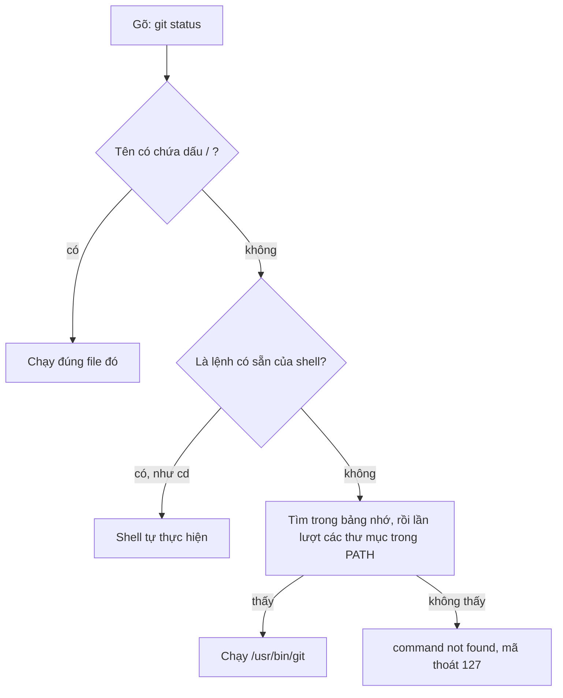

# Bài 4. Shell và hệ thống file

> Tài liệu do Claude biên soạn từ các nguồn liệt kê ở cuối, ngày 2026-11-25. Thực hành trên VPS Linux; phần lớn lệnh cũng chạy trên terminal của macOS.

## Tóm tắt

Shell là chương trình đọc lệnh bạn gõ rồi chạy chúng. Bài này giúp bạn tự tin làm việc trên server không có giao diện: hiểu cấu trúc một lệnh, biết các thư mục chuẩn của Linux chứa gì, di chuyển và thao tác với file, phân biệt hard link với symlink, xem log đang chạy, và hiểu vì sao gõ `git` thì shell biết chạy chương trình nào.

## Vì sao cần học

Khi đưa hệ thống đặt sân lên VPS, bạn chỉ có một cửa sổ SSH đen. File cấu hình nằm ở `/etc`, log nằm ở `/var/log`, ứng dụng có thể nằm ở `/opt`. Lỗi lúc 2 giờ sáng được tìm bằng `tail -f`, không phải bằng chuột.

<details>
<summary>Đoán trước khi đọc: tạo một "lối tắt" tới file, xóa file gốc đi, lối tắt có còn mở được không?</summary>

Tùy loại lối tắt. Hard link vẫn mở được vì nó trỏ thẳng tới dữ liệu; symlink thì không, vì nó chỉ chứa tên của file gốc [4]. Phần 4 có thí nghiệm chạy thật.

</details>

## Kiến thức nền

[Bài 3. Hệ điều hành](../computer-science/03-he-dieu-hanh.md): process, file descriptor, inode.

## Nội dung chính

### 1. Shell và cấu trúc một lệnh

Bash là một trình thông dịch lệnh: nó chạy các lệnh đọc từ bàn phím, từ một chuỗi, hoặc từ một file [1]. Zsh là một shell khác có cách dùng gần giống; kiểm tra mình đang dùng shell nào bằng `echo $SHELL`.

Một lệnh đơn giản là một dãy từ cách nhau bởi khoảng trắng; **từ đầu tiên là tên lệnh**, các từ còn lại là đối số truyền cho lệnh đó [1]. Theo thói quen, đối số bắt đầu bằng `-` là tùy chọn (option):

```text
ls   -l   -a   /var/log
│    │    │    └── đối số: thư mục cần liệt kê
│    └────┴─────── tùy chọn: dạng dài, kể cả file ẩn
└───────────────── tên lệnh
```

Mỗi lệnh kết thúc với một **mã thoát** (exit status); 0 nghĩa là thành công. Biến `$?` chứa mã thoát của lệnh vừa chạy [1].

Khi không nhớ cách dùng một lệnh: `man ls` mở trang hướng dẫn đầy đủ, `ls --help` in tóm tắt.

Dừng lại và tự hỏi: trong `cp -r src backup`, đâu là tên lệnh, đâu là tùy chọn, đâu là đối số?

### 2. Cây thư mục chuẩn

Linux có một cây thư mục duy nhất, bắt đầu từ thư mục gốc `/` [2]. Cách sắp xếp theo chuẩn FHS 3.0 [2]:

| Thư mục | Chứa gì |
| --- | --- |
| `/etc` | File cấu hình riêng của máy này |
| `/home` | Thư mục riêng của từng người dùng |
| `/root` | Thư mục riêng của tài khoản root |
| `/usr/bin` | Phần lớn chương trình người dùng chạy |
| `/usr/local` | Phần mềm tự cài riêng cho máy này |
| `/opt` | Các gói phần mềm cài thêm |
| `/var` | Dữ liệu thay đổi kích thước theo thời gian, như log và hàng đợi |
| `/var/log` | Các file log |
| `/var/lib` | Trạng thái của các chương trình, ví dụ dữ liệu database |
| `/tmp` | File tạm, có thể bị xóa bất cứ lúc nào, ví dụ khi khởi động lại |
| `/proc` | Thông tin về các process đang chạy và về nhân (bài 3) |
| `/dev` | File đặc biệt đại diện cho thiết bị |

Danh sách này không đầy đủ, và mỗi bản phân phối có thể sắp xếp hơi khác [2].

Dừng lại và tự hỏi: file cấu hình của Nginx và log của Nginx nhiều khả năng nằm ở đâu?

### 3. Đường dẫn và các lệnh làm việc với file

- **Đường dẫn tuyệt đối** bắt đầu bằng `/` và đi từ gốc: `/var/log/nginx/access.log`.
- **Đường dẫn tương đối** đi từ thư mục hiện tại: `logs/app.log`. Ký hiệu `.` là thư mục hiện tại, `..` là thư mục cha, `~` là thư mục home.

| Lệnh | Việc làm | Ví dụ |
| --- | --- | --- |
| `pwd` | In thư mục hiện tại | `pwd` |
| `ls` | Liệt kê | `ls -la` |
| `cd` | Đổi thư mục | `cd ~/projects` |
| `mkdir` | Tạo thư mục | `mkdir -p app/src/main` |
| `cp` | Sao chép | `cp -r src backup` |
| `mv` | Di chuyển hoặc đổi tên | `mv old.txt new.txt` |
| `rm` | Xóa (không có thùng rác) | `rm -r build` |
| `find` | Tìm file theo điều kiện | `find . -name "*.log"` |

Thử ngay (kết quả chạy thật): tạo khung dự án chỉ bằng một lệnh, rồi xem lại.

```bash
mkdir -p demo/{src,docs,logs}
find demo -type d | sort
# demo
# demo/docs
# demo/logs
# demo/src
```

`rm` xóa thẳng, không hỏi lại và không có thùng rác. Luôn kiểm tra đường dẫn trước khi chạy `rm -r`.

Dừng lại và tự hỏi: đang ở `/home/dinh/app/src`, đường dẫn tương đối tới `/home/dinh/app/logs/app.log` là gì?

### 4. Hard link và symlink

Ở bài 3, bạn đã biết mỗi file có một inode chứa siêu dữ liệu, còn tên file nằm trong thư mục.

- **Hard link** là thêm một tên nữa trỏ tới **cùng một inode**; nó không phân biệt được với tên gốc [4]. Hard link không được trỏ tới thư mục và không vượt qua ranh giới giữa các hệ thống file khác nhau [4].
- **Symlink** (symbolic link) là một file đặc biệt mà nội dung chỉ là **đường dẫn tới file khác**; nó trỏ tới một tên chứ không phải tới dữ liệu [4]. Vì vậy symlink trỏ được tới thư mục, trỏ được sang hệ thống file khác, và có thể trỏ tới một tên không tồn tại (gọi là link treo) [4].

![Hard link trỏ thẳng vào inode; symlink chỉ chứa tên file gốc [4]](assets/hard-link-va-symlink.svg)

Thử ngay (kết quả chạy thật):

```bash
echo "xin chao" > goc.txt
ln goc.txt cung.txt        # hard link
ln -s goc.txt mem.txt      # symlink
ls -li                     # cột đầu là số inode
# 876 -rw-r--r-- 2 ... cung.txt
# 876 -rw-r--r-- 2 ... goc.txt
# 877 lrwxrwxrwx 1 ... mem.txt -> goc.txt
rm goc.txt
cat cung.txt               # xin chao
cat mem.txt                # cat: mem.txt: No such file or directory
```

`goc.txt` và `cung.txt` có cùng inode 876 và số link là 2; còn symlink có inode riêng.

Dừng lại và tự hỏi: muốn trỏ `/opt/app/current` tới bản phát hành mới nhất trong `/opt/app/releases/`, nên dùng loại link nào?

### 5. Xem file và theo dõi log

| Lệnh | Dùng khi |
| --- | --- |
| `cat file` | In toàn bộ file ngắn |
| `less file` | Đọc file dài, cuộn được, gõ `/` để tìm, `q` để thoát |
| `head -n 20 file` | Xem 20 dòng đầu |
| `tail -n 50 file` | Xem 50 dòng cuối; mặc định `tail` in 10 dòng cuối [5] |
| `tail -f file` | Theo dõi: in thêm dữ liệu mới mỗi khi file dài ra [5] |

`tail -f` mặc định bám theo file descriptor đã mở, nên nếu file bị đổi tên (ví dụ khi log được xoay vòng) nó vẫn theo file cũ; muốn bám theo **tên file** thì dùng `tail -F` [5].

Thử ngay: mở hai terminal. Terminal 1 chạy `tail -f app.log`; terminal 2 chạy `echo "log 1" >> app.log` vài lần và xem terminal 1 hiện thêm dòng mới.

Dừng lại và tự hỏi: log được xoay vòng hằng đêm (`app.log` đổi thành `app.log.1`, tạo `app.log` mới). Theo dõi bằng `tail -f` hay `tail -F`?

### 6. Biến môi trường, PATH và file cấu hình shell

**Biến môi trường** là cặp tên và giá trị mà shell truyền cho các chương trình nó chạy. Xem bằng `env` hoặc `echo $HOME`.

`PATH` là danh sách các thư mục, cách nhau bởi dấu hai chấm, nơi shell tìm lệnh [3]. Khi bạn gõ `git`:



Bash nhớ đường dẫn đầy đủ của các chương trình đã tìm vào một bảng băm để không phải tìm lại; nếu không tìm thấy, nó báo lỗi và trả mã thoát 127 [6].

Thử ngay (kết quả chạy thật):

```bash
type cd ls      # cd is a shell builtin
                # ls is hashed (/usr/bin/ls)
command -v git  # /usr/bin/git
echo $PATH | tr ':' '\n'
```

Để biến môi trường và cài đặt tồn tại qua mỗi lần mở terminal, bạn ghi vào file khởi động của shell. Với bash: shell đăng nhập đọc `/etc/profile` rồi file đầu tiên tồn tại trong `~/.bash_profile`, `~/.bash_login`, `~/.profile`; shell tương tác không phải đăng nhập (như mở thêm một tab) đọc `~/.bashrc` [3]. Với zsh, file tương ứng là `~/.zshrc`.

```bash
echo 'export PATH="$HOME/.local/bin:$PATH"' >> ~/.bashrc
source ~/.bashrc   # áp dụng ngay cho terminal đang mở
```

Dừng lại và tự hỏi: vì sao ghi `PATH="$HOME/.local/bin:$PATH"` chứ không ghi `PATH="$HOME/.local/bin"`?

## Hiểu nhầm thường gặp

- **"`rm` đưa file vào thùng rác."** Không có thùng rác trên terminal; file bị xóa ngay.
- **"Symlink là bản sao của file."** Symlink chỉ chứa đường dẫn; file gốc mất thì symlink treo [4].
- **"Hard link là bản sao."** Hard link là thêm một tên cho cùng dữ liệu; sửa qua tên nào thì mọi tên đều thấy [4].
- **"`/tmp` là nơi an toàn để giữ file."** File trong `/tmp` có thể bị xóa không báo trước [2].
- **"Cài phần mềm xong mà gõ tên không chạy là cài hỏng."** Thường chỉ là thư mục chứa chương trình chưa nằm trong `PATH` [3].

## Liên hệ capstone

- Ở Giai đoạn 5, ứng dụng đặt sân sẽ được đặt trong `/opt`, cấu hình trong `/etc`, log trong `/var/log`, theo đúng bảng ở phần 2.
- Kiểu triển khai "mỗi bản phát hành một thư mục, symlink `current` trỏ vào bản đang chạy" cho phép quay về bản cũ chỉ bằng việc đổi symlink.
- `tail -F` là công cụ đầu tiên để xem log khi có sự cố trên server.

## Bài tập

Làm trên VPS hoặc terminal của bạn. Làm bài nào thì gửi bài đó để được chấm.

1. **(cơ bản)** Chỉ ra tên lệnh, tùy chọn và đối số trong `find /var/log -name "*.log" -mtime -1`.
2. **(cơ bản)** Với mỗi thứ sau, đoán thư mục chuẩn chứa nó: file cấu hình SSH server, log hệ thống, chương trình `ls`, dữ liệu của PostgreSQL, một file tải về tạm thời.
3. **(cơ bản)** Đang ở `/home/dinh/app/src`, viết đường dẫn tương đối và tuyệt đối tới `/home/dinh/app/logs/app.log`.
4. **(vận dụng)** Chỉ bằng một lệnh `mkdir`, tạo cấu trúc `court-booking/{backend/src,frontend/src,docs,scripts}`. Kiểm tra bằng `find court-booking -type d | sort`.
5. **(vận dụng)** Tạo một file, một hard link và một symlink tới nó. Dùng `ls -li` ghi lại số inode và số link. Xóa file gốc rồi giải thích kết quả khi đọc hai link.
6. **(vận dụng)** Tạo thư mục `releases/v1`, `releases/v2` và symlink `current` trỏ tới `releases/v1`. Đổi `current` sang `v2` bằng `ln -sfn`. Vì sao ở đây dùng symlink chứ không dùng hard link?
7. **(vận dụng)** Mở hai terminal, dùng `tail -f` theo dõi một file trong khi ghi thêm dòng vào nó từ terminal kia. Sau đó đổi tên file và ghi tiếp vào tên cũ; so sánh `tail -f` với `tail -F`.
8. **(vận dụng)** Chạy `type cd ls git` và `echo $PATH`. Giải thích vì sao `cd` khác `ls`.
9. **(nâng cao)** Thêm một thư mục mới vào `PATH` qua `~/.bashrc` (hoặc `~/.zshrc`) và đặt vào đó một script nhỏ có quyền chạy. Mở terminal mới và chạy script chỉ bằng tên. Ghi lại những gì cần làm để shell tìm thấy nó.
10. **(nâng cao)** Hai thư mục trong `PATH` cùng có một chương trình tên `java`. Shell sẽ chạy cái nào? Làm sao biết chắc nó đang chạy cái nào?

## Nguồn

1. [bash(1) — Linux manual page](https://man7.org/linux/man-pages/man1/bash.1.html) — mục DESCRIPTION, SHELL GRAMMAR (Simple Commands), Special Parameters — Bash 5.x — truy cập 2026-11-25
2. [hier(7) — Linux manual page](https://man7.org/linux/man-pages/man7/hier.7.html) — theo Filesystem Hierarchy Standard 3.0 — man-pages 6.19 — truy cập 2026-11-25
3. [bash(1) — Linux manual page](https://man7.org/linux/man-pages/man1/bash.1.html) — mục INVOCATION, Shell Variables (PATH) — truy cập 2026-11-25
4. [symlink(7) — Linux manual page](https://man7.org/linux/man-pages/man7/symlink.7.html) — man-pages 6.19 — truy cập 2026-11-25
5. [tail(1) — Linux manual page](https://man7.org/linux/man-pages/man1/tail.1.html) — GNU coreutils 9.11 — truy cập 2026-11-25
6. [GNU Bash Reference Manual: Command Search and Execution](https://www.gnu.org/software/bash/manual/html_node/Command-Search-and-Execution.html) — truy cập 2026-11-25

## Đọc thêm

- `man bash`, mục EXPANSION: cách shell xử lý `~`, `*`, `{a,b}` trước khi chạy lệnh.
- Sách *The Linux Command Line* (William Shotts), phần 1.

## Báo cáo kiểm chứng

- Số nguồn: 6, đều hạng A (man page chính thức và tài liệu của GNU Bash). Trang chuẩn FHS của Linux Foundation chặn công cụ đọc tự động, nên dùng `hier(7)` (ghi rõ theo FHS 3.0) thay thế. Trang `bash(1)` chỉ đọc 100.000 ký tự đầu, đủ cho các mục đã trích.
- Khẳng định đã trích dẫn: 22.
- Đánh dấu chưa kiểm chứng: 0. Câu về zsh và `~/.zshrc` là hướng dẫn thao tác, không khẳng định hành vi mặc định của macOS.
- Lệnh đã chạy thật: `ln`, `ln -s`, `ls -li`, `rm` rồi `cat` hai link, `mkdir -p demo/{src,docs,logs}` kèm `find`, `type cd ls`, `command -v git`, `echo $PATH`, `tail -f` trên file đang được ghi.
- Hình: 1 SVG (số inode và nội dung lấy từ thí nghiệm thật), 1 sơ đồ Mermaid (thứ tự tìm lệnh theo [6] và kết quả `type`).
