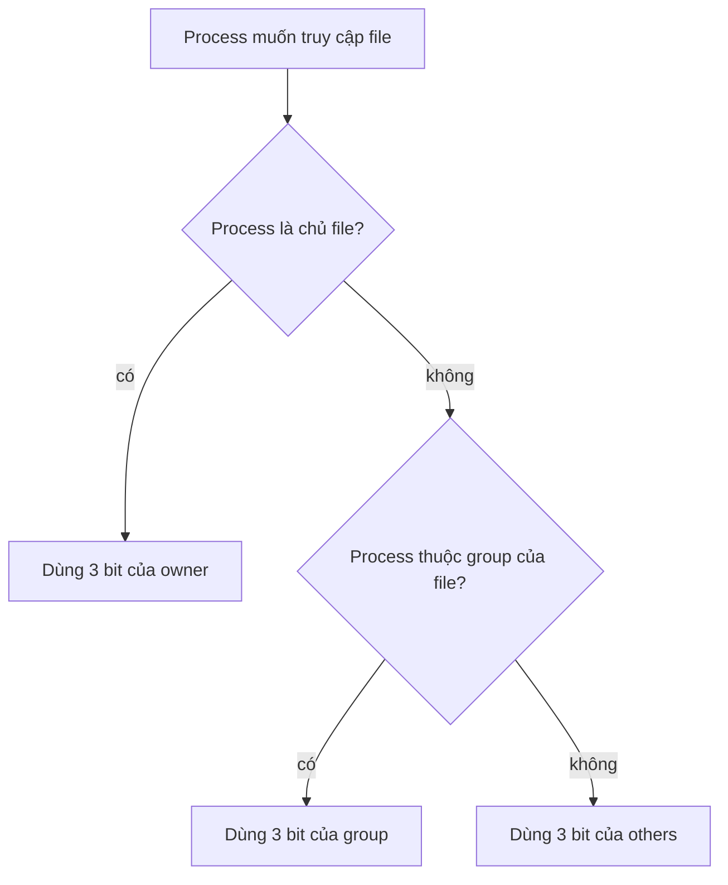
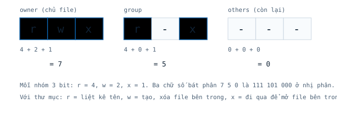

# Bài 5. User, group và phân quyền

> Tài liệu do Claude biên soạn từ các nguồn liệt kê ở cuối, ngày 2026-11-25. Thực hành trên VPS Linux; các lệnh tạo user cần quyền `sudo`.

## Tóm tắt

Linux quyết định ai được đọc, ghi, chạy file nào dựa trên ba thứ: user, group và 9 bit quyền của file. Bài này giúp bạn đọc và đặt quyền đúng (750, 644, 600), hiểu quyền trên thư mục khác quyền trên file ra sao, dùng `sudo` an toàn, và chạy ứng dụng bằng một user riêng thay vì root.

## Vì sao cần học

File cấu hình của hệ thống đặt sân chứa mật khẩu database và khóa ký token. Nếu quyền đặt sai, bất kỳ ai đăng nhập được vào server đều đọc được. Nếu ứng dụng chạy bằng root và bị khai thác, kẻ tấn công có toàn quyền trên máy.

<details>
<summary>Đoán trước khi đọc: một thư mục cho phép đọc (r) nhưng không cho đi qua (x). Liệt kê được tên file bên trong không? Mở được file bên trong không?</summary>

Liệt kê được tên, nhưng không mở được file nào [1]. Thí nghiệm ở phần 3.

</details>

## Kiến thức nền

- [Bài 1. Biểu diễn dữ liệu](../computer-science/01-bieu-dien-du-lieu.md): bit và hệ cơ số, dùng để đọc quyền dạng số.
- [Bài 4. Shell và hệ thống file](04-shell-va-he-thong-file.md): đường dẫn, `ls -l`.

## Nội dung chính

### 1. User, group và root

Mỗi process chạy dưới danh nghĩa một **user** (có số UID) và thuộc một hoặc nhiều **group** (số GID). Xem bằng lệnh `id`:

```bash
id
# uid=1016(dinh) gid=1016(dinh) groups=1016(dinh)
```

Thông tin tài khoản nằm trong `/etc/passwd`, mật khẩu đã mã hóa nằm riêng trong `/etc/shadow`, nhóm nằm trong `/etc/group` [3].

**root** là user có UID 0. Trên Unix truyền thống, root vượt qua mọi kiểm tra quyền khi truy cập file [1]. Đây chính là lý do không nên làm việc hằng ngày, hay chạy ứng dụng, bằng root.

### 2. Chín bit quyền và cách đọc dạng số

Mỗi file có 3 nhóm, mỗi nhóm 3 bit [1]:

- Nhóm thứ nhất áp dụng khi process là **chủ file** (owner).
- Nhóm thứ hai áp dụng khi process thuộc **group của file**.
- Nhóm thứ ba áp dụng cho **mọi người còn lại** (others).

Trong mỗi nhóm, bit đầu là đọc (r), bit giữa là ghi (w), bit cuối là chạy (x) với file thường, hoặc là "tìm kiếm" (đi qua) với thư mục [1].



Chỉ **một** nhóm bit được dùng, theo thứ tự ở trên [1]. Vì vậy nếu chủ file bị tước quyền đọc thì chủ file không đọc được, kể cả khi others được đọc.

**Dạng số bát phân:** r = 4, w = 2, x = 1, cộng lại trong mỗi nhóm. Hằng số trong `inode(7)` cũng ghi đúng như vậy, ví dụ 00400 là chủ file được đọc, 00040 là group được đọc [4].



| Số | Dạng chữ | Dùng cho |
| --- | --- | --- |
| 755 | `rwxr-xr-x` | Thư mục, chương trình mọi người được chạy |
| 750 | `rwxr-x---` | Thư mục ứng dụng: chủ toàn quyền, group được đọc và đi qua |
| 644 | `rw-r--r--` | File thường ai cũng đọc được |
| 640 | `rw-r-----` | File cấu hình group được đọc |
| 600 | `rw-------` | File bí mật: chỉ chủ file đọc, ghi |

Dừng lại và tự hỏi: quyền 754 cho others làm được gì?

### 3. Quyền trên thư mục khác quyền trên file

Với thư mục, ba bit mang nghĩa khác:

| Bit | Trên file | Trên thư mục |
| --- | --- | --- |
| r | Đọc nội dung | Liệt kê tên các mục bên trong |
| w | Sửa nội dung | Tạo, xóa, đổi tên các mục bên trong |
| x | Chạy như chương trình | Đi qua để truy cập các mục bên trong |

Khi phân giải một đường dẫn, nếu process không có quyền tìm kiếm (x) trên một thư mục nằm giữa đường dẫn, kết quả là lỗi "Permission denied" [1].

Thử ngay (kết quả chạy thật, với tư cách chủ thư mục):

```bash
mkdir d && touch d/x
chmod 644 d          # có r, không có x
ls d                 # x          (liệt kê được tên)
cat d/x              # cat: d/x: Permission denied   (không đi qua được)

chmod 555 d          # không có w
touch d/moi          # touch: cannot touch 'd/moi': Permission denied
rm -f d/x            # rm: cannot remove 'd/x': Permission denied
```

Kết quả cuối rất quan trọng: **xóa một file phụ thuộc vào quyền w của thư mục chứa nó**, không phụ thuộc vào quyền của chính file đó.

Dừng lại và tự hỏi: thư mục `/tmp` ai cũng ghi được, vậy vì sao người này không xóa được file của người kia trong đó? (Gợi ý: tìm "sticky bit" trong `inode(7)`.)

### 4. chmod, chown và umask

```bash
chmod 640 config.yml          # đặt quyền dạng số
chmod u=rwx,g=rx,o= app/      # dạng chữ: u owner, g group, o others
chmod -R 750 /opt/app         # đổi cho cả cây thư mục
sudo chown appuser:appuser config.yml   # đổi chủ và group
stat -c '%a %A %n' config.yml           # xem quyền dạng số và dạng chữ
```

**umask** là mặt nạ quyết định quyền mặc định của file mới tạo: các bit có trong umask sẽ bị tắt khỏi quyền mà chương trình yêu cầu [2]. Giá trị thường gặp là 022; khi đó file được tạo với quyền 0666 sẽ có quyền 0644, vì 0666 & ~022 = 0644 [2].

Thử ngay (kết quả chạy thật):

```bash
umask                         # 0022
touch f && mkdir dd && stat -c '%a %n' f dd
# 644 f
# 755 dd
(umask 077; touch secret; stat -c '%a %n' secret)
# 600 secret
printf '%o\n' $(( 0666 & ~0022 ))   # 644, đúng công thức
```

Dừng lại và tự hỏi: muốn mọi file mà ứng dụng tạo ra chỉ chủ file đọc được, đặt umask bằng bao nhiêu?

### 5. sudo và file sudoers

`sudo` cho phép một user **được cấp quyền** chạy một lệnh với tư cách root hoặc user khác, theo chính sách bảo mật [5]. Chính sách mặc định cấu hình trong `/etc/sudoers`, và nên sửa file này bằng `visudo` để không lỡ tay để lại lỗi cú pháp [5]. Theo mặc định, sau khi nhập mật khẩu, bạn không phải nhập lại trong 5 phút trên cùng terminal [5].

Một lưu ý bảo mật quan trọng từ chính tài liệu của sudo: cho phép ai đó chạy `sudo` với một shell, hoặc với các chương trình có thể mở shell như trình soạn thảo, gần như là trao cho họ toàn quyền root [5].

```bash
sudo -l                 # xem mình được phép chạy những gì qua sudo
sudo -u appuser whoami  # chạy một lệnh với tư cách appuser
```

### 6. Quyền tối thiểu: chạy ứng dụng bằng user riêng

Nguyên tắc: mỗi chương trình chỉ có đúng những quyền nó cần. Vì root vượt qua mọi kiểm tra quyền [1], một ứng dụng chạy bằng root mà bị khai thác thì kẻ tấn công làm được mọi thứ. Chạy bằng một user riêng thì thiệt hại bị giới hạn trong những gì user đó được phép.

`useradd -r` tạo **tài khoản hệ thống**: UID nằm trong dải dành cho hệ thống và không tạo thư mục home [3]. Đặt shell đăng nhập là `/usr/sbin/nologin` để tài khoản không đăng nhập được:

```bash
/usr/sbin/nologin; echo "exit=$?"
# This account is currently not available.
# exit=1
```

Quy trình cho ứng dụng đặt sân (cần `sudo`, chưa chạy trong môi trường soạn bài vì không có quyền root):

```bash
sudo useradd -r -s /usr/sbin/nologin appuser
sudo mkdir -p /opt/court-booking
sudo chown -R appuser:appuser /opt/court-booking
sudo chmod 750 /opt/court-booking
sudo chmod 600 /opt/court-booking/config/secrets.env
```

Kết quả: chỉ `appuser` đọc được file bí mật; thành viên group `appuser` được xem thư mục ứng dụng; những người còn lại không thấy gì.

Dừng lại và tự hỏi: vì sao file bí mật để 600 chứ không phải 640?

## Hiểu nhầm thường gặp

- **"chmod 777 cho chắc ăn."** Như vậy là ai cũng đọc, sửa, xóa được; đó là lỗ hổng, không phải cách sửa lỗi.
- **"File có quyền 600 thì không ai xóa được."** Quyền xóa nằm ở thư mục chứa file (chạy thật ở phần 3).
- **"Có quyền r trên thư mục là mở được file bên trong."** Còn cần quyền x trên thư mục [1].
- **"Chủ file luôn có quyền."** Chỉ nhóm bit owner được dùng cho chủ file [1]; owner bị tắt quyền thì chủ file cũng bị chặn (root là ngoại lệ).
- **"Cho sudo vim là vô hại, chỉ để sửa file."** Trình soạn thảo có thể mở shell, nên gần như là cho root [5].

## Liên hệ capstone

- Ở Giai đoạn 5, ứng dụng đặt sân chạy bằng user riêng không đăng nhập được, thư mục `/opt/court-booking` để 750, file bí mật để 600.
- Biến môi trường chứa mật khẩu database (Giai đoạn 2) đặt trong file có quyền 600, không đưa vào Git.
- Chỉ những tài khoản quản trị mới có `sudo`, và chỉ cho những lệnh cần thiết.

## Bài tập

Làm trên VPS (cần `sudo` cho bài 7 đến 9). Làm bài nào thì gửi bài đó để được chấm.

1. **(cơ bản)** Đổi sang dạng chữ: 755, 640, 600, 711. Đổi sang dạng số: `rwxr-x---`, `rw-rw-r--`, `r--------`.
2. **(cơ bản)** Quyền 750 trên một thư mục: chủ, group, others làm được gì?
3. **(cơ bản)** Với umask 027, file mới (yêu cầu 0666) và thư mục mới (yêu cầu 0777) có quyền bao nhiêu? Kiểm tra bằng `printf '%o\n' $(( 0666 & ~0027 ))`.
4. **(vận dụng)** Lặp lại thí nghiệm ở phần 3: thư mục có r mà không có x, rồi có x mà không có r. Ghi lại lệnh nào chạy được, lệnh nào bị chặn, và giải thích.
5. **(vận dụng)** Tạo một file quyền 000 do chính bạn sở hữu. Bạn có đọc được không? Bạn có xóa được không? Giải thích bằng phần 2 và phần 3.
6. **(vận dụng)** Tìm hiểu sticky bit trong `inode(7)`, rồi chạy `ls -ld /tmp`. Chữ `t` ở cuối nghĩa là gì, và nó bảo vệ điều gì?
7. **(vận dụng)** Trên VPS, tạo user hệ thống `appuser` không đăng nhập được. Thử `sudo su - appuser` và giải thích kết quả.
8. **(vận dụng)** Tạo `/opt/court-booking` với file `config/secrets.env`, đặt chủ và quyền như phần 6. Dùng tài khoản thường của bạn thử `cat` file bí mật, rồi `sudo -u appuser cat` file đó.
9. **(nâng cao)** Chạy `sudo -l` trên VPS của bạn. Tài khoản của bạn được phép chạy những gì qua sudo? Nếu được chạy mọi lệnh, điều đó có rủi ro gì?
10. **(nâng cao)** Một ứng dụng web cần ghi file upload vào `/opt/court-booking/uploads` và đọc mã nguồn ở `/opt/court-booking/app`, nhưng không được sửa mã nguồn. Đề xuất chủ sở hữu và quyền cho hai thư mục này.

## Nguồn

1. [path_resolution(7) — Linux manual page](https://man7.org/linux/man-pages/man7/path_resolution.7.html) — mục Step 2, Permissions, Bypassing permission checks — man-pages 6.19 — truy cập 2026-11-25
2. [umask(2) — Linux manual page](https://man7.org/linux/man-pages/man2/umask.2.html) — man-pages 6.19 — truy cập 2026-11-25
3. [useradd(8) — Linux manual page](https://man7.org/linux/man-pages/man8/useradd.8.html) — tùy chọn -r, -s, mục FILES — shadow-utils 4.19.0 — truy cập 2026-11-25
4. [inode(7) — Linux manual page](https://man7.org/linux/man-pages/man7/inode.7.html) — mục The file type and mode — man-pages 6.19 — truy cập 2026-11-25
5. [Sudo Manual](https://www.sudo.ws/docs/man/sudo.man/) — mục DESCRIPTION, SECURITY NOTES, CAVEATS — truy cập 2026-11-25

## Đọc thêm

- [Sudoers Manual](https://www.sudo.ws/docs/man/sudoers.man/): cú pháp cấp quyền chi tiết trong `/etc/sudoers`.
- `man 7 capabilities`: Linux chia quyền của root thành nhiều "capability" nhỏ.

## Báo cáo kiểm chứng

- Số nguồn: 5, đều hạng A (man page chính thức và tài liệu của dự án sudo).
- Khẳng định đã trích dẫn: 21.
- Đánh dấu chưa kiểm chứng: 0. Ý nghĩa bit w trên thư mục (tạo, xóa mục bên trong) được xác nhận bằng thí nghiệm chạy thật thay vì trích dẫn.
- Lệnh đã chạy thật: `id`, `umask`, `touch`/`mkdir` kèm `stat`, `chmod 640`, `chmod u=rwx,g=rx,o=`, thí nghiệm thư mục 644 và 555, `umask 077`, phép tính `0666 & ~0022`, `/usr/sbin/nologin`.
- Chưa chạy trong môi trường soạn bài (không có quyền root): `useradd`, `chown`, `sudo`; đã ghi rõ trong bài.
- Hình: 1 SVG (giải mã quyền 750), 1 sơ đồ Mermaid (thứ tự chọn nhóm bit theo [1]).
