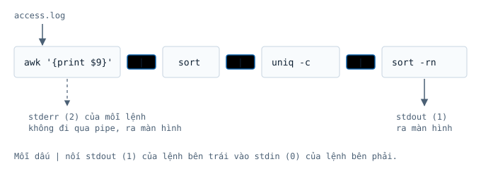

# Bài 6. Xử lý văn bản và pipe

> Tài liệu do Claude biên soạn từ các nguồn liệt kê ở cuối, ngày 2026-11-25. Mọi ví dụ chạy trên một file log Nginx mẫu đúng định dạng thật; kết quả in trong bài là kết quả chạy thật.

## Tóm tắt

Mỗi lệnh Linux làm tốt một việc nhỏ: lọc dòng, cắt cột, sắp xếp, đếm. Nối chúng bằng pipe `|`, bạn trả lời được những câu hỏi như "IP nào gọi nhiều nhất", "có bao nhiêu lỗi 500 trong một giờ qua" chỉ với một dòng lệnh. Bài này dạy ba luồng dữ liệu chuẩn, cách chuyển hướng chúng, và bộ công cụ xử lý văn bản: `grep`, `cut`, `awk`, `sed`, `sort`, `uniq`, `wc`, `xargs`.

## Vì sao cần học

Khi hệ thống đặt sân chậm bất thường, câu hỏi đầu tiên là "có ai đang gọi API quá nhiều không?". Câu trả lời nằm trong access log của Nginx, có thể dài hàng triệu dòng. Không ai mở file đó bằng trình soạn thảo; người ta dùng pipe.

<details>
<summary>Đoán trước khi đọc: <code>awk '{print $1}' access.log | uniq -c</code> có đếm đúng số request của từng IP không?</summary>

Không, trừ khi các dòng của cùng một IP nằm liền nhau. `uniq` chỉ gộp các dòng trùng **đứng cạnh nhau**; phải `sort` trước [4]. Phần 4 có kết quả chạy thật.

</details>

## Kiến thức nền

- [Bài 3. Hệ điều hành](../computer-science/03-he-dieu-hanh.md): file descriptor 0, 1, 2.
- [Bài 4. Shell và hệ thống file](04-shell-va-he-thong-file.md): cấu trúc lệnh, `tail`.

## Nội dung chính

### 1. Ba luồng chuẩn và chuyển hướng

Mỗi process khởi động với ba file descriptor (bài 3):

| Số | Tên | Mặc định |
| --- | --- | --- |
| 0 | stdin, đầu vào chuẩn | Bàn phím |
| 1 | stdout, đầu ra chuẩn | Màn hình |
| 2 | stderr, lỗi chuẩn | Màn hình |

Chuyển hướng (redirect) đổi nơi các luồng này đọc hoặc ghi:

| Viết | Ý nghĩa |
| --- | --- |
| `lệnh > file` | Ghi stdout vào file, **xóa nội dung cũ** |
| `lệnh >> file` | Ghi stdout **nối vào cuối** file |
| `lệnh 2> file` | Ghi stderr vào file |
| `lệnh > file 2>&1` | Ghi stdout vào file, rồi cho stderr đi theo stdout: cả hai vào file |
| `lệnh < file` | Lấy stdin từ file |

`2>&1` đọc là "cho luồng 2 trỏ tới nơi luồng 1 **đang** trỏ tới". Vì vậy **thứ tự quan trọng**. Thử ngay (kết quả chạy thật):

```bash
ls khongco > out1.txt 2>&1    # màn hình không in gì
cat out1.txt                  # ls: cannot access 'khongco': No such file or directory

ls khongco 2>&1 > out2.txt    # lỗi vẫn in ra màn hình
wc -c < out2.txt              # 0: file rỗng
```

Ở lệnh thứ hai, lúc `2>&1` chạy thì stdout vẫn đang là màn hình, nên stderr trỏ ra màn hình; sau đó stdout mới bị đổi sang file.

```bash
echo a > f; echo b > f; cat f    # b        (> ghi đè)
echo c >> f; cat f               # b, c     (>> nối thêm)
```

Dừng lại và tự hỏi: muốn chạy một lệnh mà bỏ hẳn mọi thông báo lỗi, chuyển stderr đi đâu? (Gợi ý: `/dev/null`.)

### 2. Pipe

**Pipe** `|` nối stdout của lệnh bên trái vào stdin của lệnh bên phải [1]. Mỗi lệnh trong pipeline chạy trong một process riêng [1], nên các lệnh chạy cùng lúc và dữ liệu chảy qua từng dòng một. Lưu ý: chỉ stdout đi qua pipe; stderr vẫn ra màn hình. Muốn cả stderr đi qua thì dùng `|&`, viết tắt của `2>&1 |` [1].



Mã thoát của cả pipeline là mã thoát của lệnh cuối cùng, trừ khi bật tùy chọn `pipefail` [1].

### 3. Định dạng access log của Nginx

Nếu không chỉ định định dạng, Nginx ghi access log theo định dạng có sẵn tên là `combined` [5]:

```text
$remote_addr - $remote_user [$time_local] "$request" $status $body_bytes_sent "$http_referer" "$http_user_agent"
```

Một dòng trong file mẫu:

```text
203.0.113.5 - - [25/Nov/2026:08:00:01 +0700] "GET /api/courts HTTP/1.1" 200 512 "-" "Mozilla/5.0"
```

Tách theo dấu cách, cột 1 là IP, cột 9 là status code, cột 10 là số byte trả về. Hai số này sẽ được dùng liên tục ở phần dưới.

### 4. Bộ công cụ

**grep: lọc dòng.** `grep` tìm mẫu trong từng file và in ra mỗi dòng khớp [2]. Các tùy chọn hay dùng [2]:

| Tùy chọn | Tác dụng |
| --- | --- |
| `-i` | Không phân biệt hoa thường |
| `-v` | Đảo ngược: lấy dòng **không** khớp |
| `-c` | Chỉ in số dòng khớp |
| `-n` | In kèm số thứ tự dòng |
| `-E` | Dùng biểu thức chính quy mở rộng (ERE) |
| `-r` | Tìm đệ quy trong cả thư mục |

```bash
grep -c ' 404 ' access.log          # 2
grep -n 'POST' access.log           # các dòng POST kèm số dòng
grep -v '"GET' access.log           # mọi request không phải GET
```

Biểu thức chính quy cơ bản đủ dùng cho bài này: `.` một ký tự bất kỳ, `*` lặp 0 hoặc nhiều lần, `^` đầu dòng, `$` cuối dòng, `[0-9]` một chữ số, `(a|b)` a hoặc b (cần `-E`).

**cut và awk: lấy cột.**

```bash
cut -d' ' -f1 access.log | head -2   # 203.0.113.5, 198.51.100.7
awk '{print $1, $9}' access.log      # IP và status
awk '$9 >= 500' access.log           # chỉ các dòng có status từ 500 trở lên
```

`cut` cắt theo một ký tự phân cách cố định; `awk` tự tách theo khoảng trắng và còn so sánh, tính toán được trên từng cột.

**sed: sửa dòng trên đường đi.**

```bash
sed -n '2,3p' access.log                       # chỉ in dòng 2 đến 3
sed 's/Mozilla\/5.0/BROWSER/' access.log       # thay chuỗi đầu tiên khớp trên mỗi dòng
```

**sort, uniq, wc: sắp xếp, gộp, đếm.**

`uniq` chỉ gộp các dòng trùng **liền kề**; muốn đếm đúng thì phải `sort` trước, `uniq -c` in kèm số lần xuất hiện [4]. Thử ngay (kết quả chạy thật):

```bash
awk '{print $1}' access.log | uniq -c | head -4
#   1 203.0.113.5
#   1 198.51.100.7
#   1 203.0.113.5     <- cùng IP nhưng không liền kề nên bị đếm tách
#   1 192.0.2.44

awk '{print $1}' access.log | sort | uniq -c | sort -rn
#   5 203.0.113.5
#   3 192.0.2.44
#   2 198.51.100.7
```

`sort -rn` sắp theo số (`-n`), từ lớn xuống nhỏ (`-r`). `wc -l` đếm số dòng.

**xargs: biến dòng thành đối số.** `xargs` đọc các mục từ stdin, ngăn cách bởi khoảng trắng hoặc xuống dòng, rồi chạy một lệnh với các mục đó làm đối số [3]. Vì tên file có thể chứa dấu cách, cách an toàn là để `find` in tên ngăn cách bằng ký tự null (`-print0`) và để `xargs` đọc theo kiểu đó (`-0`) [3]:

```bash
touch "a b.log" c.log
find . -name "*.log" -print | xargs ls      # ls: cannot access './a': No such file or directory
find . -name "*.log" -print0 | xargs -0 ls  # đúng: ./a b.log  ./c.log ...
```

### 5. Hai câu hỏi thực tế, mỗi câu một dòng lệnh

**Đếm số request theo status code:**

```bash
awk '{print $9}' access.log | sort | uniq -c | sort -rn
#   4 200
#   2 404
#   1 500
#   1 409
#   1 403
#   1 201
```

**10 IP gọi nhiều nhất:**

```bash
awk '{print $1}' access.log | sort | uniq -c | sort -rn | head -10
```

**Tìm các dòng ERROR trong 1.000 dòng log cuối:**

```bash
tail -n 1000 app.log | grep ERROR
```

Đọc từ trái sang phải giống như đọc một câu: "lấy cột 9, sắp xếp, đếm các giá trị giống nhau, sắp theo số lượng giảm dần".

Dừng lại và tự hỏi: IP `192.0.2.44` trong file mẫu gọi `/admin`, `/wp-login.php`, `/.env`. Bạn nghĩ nó đang làm gì?

## Hiểu nhầm thường gặp

- **"`uniq -c` đếm số lần xuất hiện."** Chỉ đúng với các dòng trùng liền kề; phải `sort` trước [4].
- **"Regex khớp là đúng cột."** Thử ngay: `grep -cE ' (4|5)[0-9]{2} '` để đếm request lỗi trả về 8 trên file mẫu, trong khi thực tế chỉ có 5, vì regex khớp cả cột số byte như ` 512 `. Lọc theo cột bằng `awk '$9 >= 400'` mới cho kết quả đúng.
- **"`> file 2>&1` và `2>&1 > file` là như nhau."** Thứ tự quyết định kết quả (chạy thật ở phần 1).
- **"Lỗi của lệnh đầu cũng đi qua pipe."** Chỉ stdout đi qua pipe; muốn cả stderr thì dùng `|&` [1].
- **"`xargs` luôn an toàn với tên file."** Tên có dấu cách sẽ bị tách sai nếu không dùng `-print0` và `-0` [3].

## Liên hệ capstone

- Khi chạy thật ở Giai đoạn 5, đây là bộ công cụ đầu tiên để trả lời "endpoint nào lỗi nhiều", "IP nào đang dò quét" (như `192.0.2.44` gọi `/.env`), trước khi có hệ thống giám sát.
- Giới hạn tần suất gọi API (rate limiting) ở Giai đoạn 2 xuất phát từ đúng loại phân tích ở phần 5: tìm ra ai đang gọi quá nhiều.

## Bài tập

Tạo file `access.log` mẫu bằng 10 dòng ở dưới (hoặc lấy log Nginx thật trên VPS), rồi làm bài. Làm bài nào thì gửi bài đó để được chấm.

```text
203.0.113.5 - - [25/Nov/2026:08:00:01 +0700] "GET /api/courts HTTP/1.1" 200 512 "-" "Mozilla/5.0"
198.51.100.7 - - [25/Nov/2026:08:00:02 +0700] "POST /api/bookings HTTP/1.1" 201 128 "-" "Mozilla/5.0"
203.0.113.5 - - [25/Nov/2026:08:00:03 +0700] "GET /api/courts/3 HTTP/1.1" 200 256 "-" "Mozilla/5.0"
192.0.2.44 - - [25/Nov/2026:08:00:04 +0700] "GET /admin HTTP/1.1" 403 64 "-" "curl/8.5.0"
203.0.113.5 - - [25/Nov/2026:08:00:05 +0700] "POST /api/bookings HTTP/1.1" 409 96 "-" "Mozilla/5.0"
198.51.100.7 - - [25/Nov/2026:08:00:06 +0700] "GET /api/courts HTTP/1.1" 200 512 "-" "Mozilla/5.0"
192.0.2.44 - - [25/Nov/2026:08:00:07 +0700] "GET /wp-login.php HTTP/1.1" 404 32 "-" "curl/8.5.0"
203.0.113.5 - - [25/Nov/2026:08:00:08 +0700] "GET /api/me HTTP/1.1" 500 48 "-" "Mozilla/5.0"
192.0.2.44 - - [25/Nov/2026:08:00:09 +0700] "GET /.env HTTP/1.1" 404 32 "-" "curl/8.5.0"
203.0.113.5 - - [25/Nov/2026:08:00:10 +0700] "GET /api/courts HTTP/1.1" 200 512 "-" "Mozilla/5.0"
```

1. **(cơ bản)** Giải thích `2>&1`. Viết lệnh chạy `ls` trên một thư mục không tồn tại mà không in gì ra màn hình.
2. **(cơ bản)** Đếm số request trong file mẫu bằng `wc`, và số request POST bằng `grep`.
3. **(cơ bản)** In cột IP và cột status của mọi dòng.
4. **(vận dụng)** Đếm số request theo status code, sắp giảm dần. So sánh với kết quả trong phần 5.
5. **(vận dụng)** Tìm 3 IP gọi nhiều nhất bằng một dòng lệnh.
6. **(vận dụng)** Liệt kê các đường dẫn (URL) bị trả về 404, mỗi đường dẫn một lần.
7. **(vận dụng)** Tính tổng số byte đã trả về (cột 10) bằng `awk`.
8. **(vận dụng)** Viết lệnh tìm tất cả dòng chứa ERROR trong 1.000 dòng cuối của `app.log`, kèm số dòng.
9. **(nâng cao)** Đếm request lỗi (status từ 400 trở lên) theo từng IP. Vì sao không nên dùng `grep` với regex số để lọc status ở đây?
10. **(nâng cao)** Tìm mọi file `.log` trong một thư mục (kể cả tên có dấu cách) và đếm tổng số dòng của chúng bằng `find`, `xargs` và `wc`.

## Nguồn

1. [bash(1) — Linux manual page](https://man7.org/linux/man-pages/man1/bash.1.html) — mục SHELL GRAMMAR, Pipelines — truy cập 2026-11-25
2. [grep(1) — Linux manual page](https://man7.org/linux/man-pages/man1/grep.1.html) — GNU grep 3.12 — truy cập 2026-11-25
3. [xargs(1) — Linux manual page](https://man7.org/linux/man-pages/man1/xargs.1.html) — GNU findutils — truy cập 2026-11-25
4. [uniq(1) — Linux manual page](https://man7.org/linux/man-pages/man1/uniq.1.html) — GNU coreutils 9.11 — truy cập 2026-11-25
5. [nginx: Module ngx_http_log_module](https://nginx.org/en/docs/http/ngx_http_log_module.html) — chỉ thị access_log, log_format combined — truy cập 2026-11-25

## Đọc thêm

- `man 7 regex`: cú pháp biểu thức chính quy cơ bản và mở rộng.
- [The GNU Awk User's Guide](https://www.gnu.org/software/gawk/manual/): awk còn là một ngôn ngữ nhỏ, đủ để viết báo cáo từ log.

## Báo cáo kiểm chứng

- Số nguồn: 5, đều hạng A (man page chính thức và tài liệu Nginx).
- Khẳng định đã trích dẫn: 14. Phần chuyển hướng (`>`, `>>`, thứ tự của `2>&1`) được chứng minh bằng thí nghiệm chạy thật thay vì trích dẫn, vì mục REDIRECTION của `bash(1)` nằm ngoài đoạn trang đã đọc.
- Đánh dấu chưa kiểm chứng: 0.
- Lệnh đã chạy thật trên file log mẫu 10 dòng: đếm status, top IP, `uniq` không `sort`, `cut`, `grep -c`, `sed -n`, `sed s///`, thứ tự chuyển hướng, `>` và `>>`, `xargs` có và không có `-0`, `tail | grep` trên file 1.200 dòng. Lỗi đếm sai bằng regex (8 thay vì 5) là kết quả chạy thật.
- Hình: 1 SVG (luồng dữ liệu qua pipeline).
